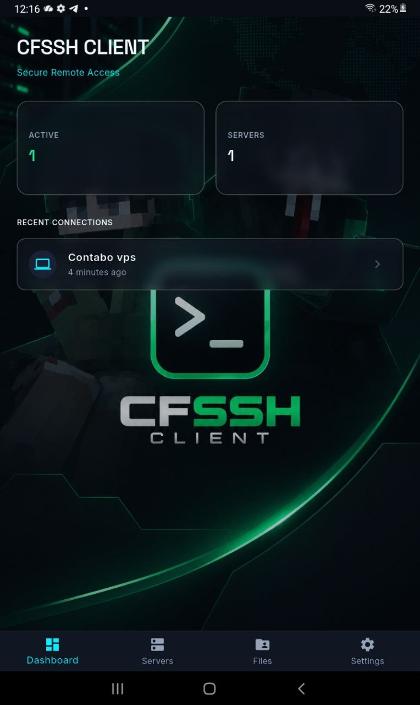
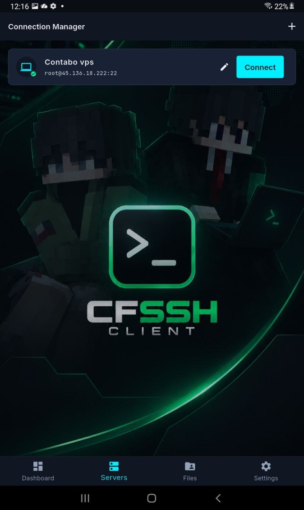
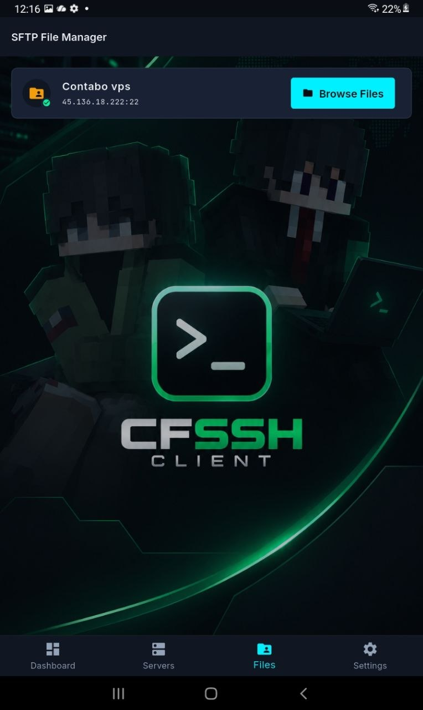
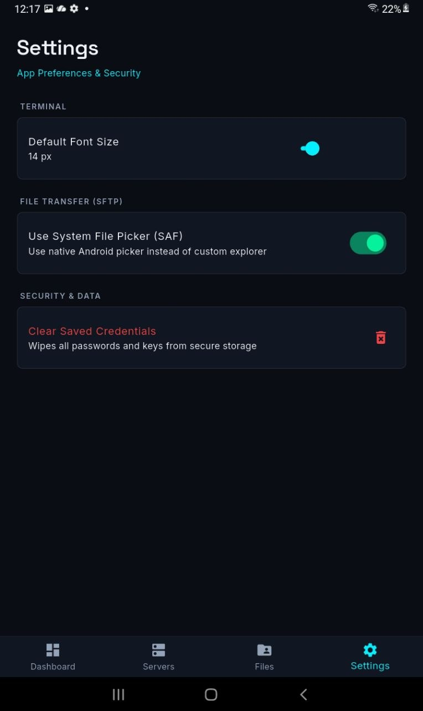

This file is a merged representation of the entire codebase, combined into a single document by Repomix.
The content has been processed where empty lines have been removed, content has been compressed (code blocks are separated by ⋮---- delimiter).

# File Summary

## Purpose
This file contains a packed representation of the entire repository's contents.
It is designed to be easily consumable by AI systems for analysis, code review,
or other automated processes.

## File Format
The content is organized as follows:
1. This summary section
2. Repository information
3. Directory structure
4. Repository files (if enabled)
5. Multiple file entries, each consisting of:
  a. A header with the file path (## File: path/to/file)
  b. The full contents of the file in a code block

## Usage Guidelines
- This file should be treated as read-only. Any changes should be made to the
  original repository files, not this packed version.
- When processing this file, use the file path to distinguish
  between different files in the repository.
- Be aware that this file may contain sensitive information. Handle it with
  the same level of security as you would the original repository.

## Notes
- Some files may have been excluded based on .gitignore rules and Repomix's configuration
- Binary files are not included in this packed representation. Please refer to the Repository Structure section for a complete list of file paths, including binary files
- Files matching patterns in .gitignore are excluded
- Files matching default ignore patterns are excluded
- Empty lines have been removed from all files
- Content has been compressed - code blocks are separated by ⋮---- delimiter
- Files are sorted by Git change count (files with more changes are at the bottom)

# Directory Structure
````
android/
  app/
    src/
      debug/
        AndroidManifest.xml
      main/
        kotlin/
          com/
            cfssh/
              cfssh_client/
                MainActivity.kt
        res/
          drawable/
            background.png
            launch_background.xml
            splash.png
          drawable-hdpi/
            android12splash.png
          drawable-land/
            background.png
            splash.png
          drawable-mdpi/
            android12splash.png
          drawable-night-hdpi/
            android12splash.png
          drawable-night-mdpi/
            android12splash.png
          drawable-night-xhdpi/
            android12splash.png
          drawable-night-xxhdpi/
            android12splash.png
          drawable-night-xxxhdpi/
            android12splash.png
          drawable-port/
            background.png
            splash.png
          drawable-v21/
            background.png
            launch_background.xml
          drawable-xhdpi/
            android12splash.png
          drawable-xxhdpi/
            android12splash.png
          drawable-xxxhdpi/
            android12splash.png
          mipmap-hdpi/
            ic_launcher.png
            launcher_icon.png
          mipmap-mdpi/
            ic_launcher.png
            launcher_icon.png
          mipmap-xhdpi/
            ic_launcher.png
            launcher_icon.png
          mipmap-xxhdpi/
            ic_launcher.png
            launcher_icon.png
          mipmap-xxxhdpi/
            ic_launcher.png
            launcher_icon.png
          values/
            styles.xml
          values-night/
            styles.xml
          values-night-v31/
            styles.xml
          values-v31/
            styles.xml
        AndroidManifest.xml
      profile/
        AndroidManifest.xml
    build.gradle.kts
  gradle/
    wrapper/
      gradle-wrapper.properties
  .gitignore
  build.gradle.kts
  gradle.properties
  settings.gradle.kts
assets/
  background_horizontal.png
  background_vertical.png
  launcher_icon.png
  logo.png
  splash_horizontal.png
  splash_vertical.png
  ss1.jpg
  ss2.jpg
  ss3.jpg
  ss4.jpg
lib/
  models/
    connection_history.dart
    connection_profile.dart
    ssh_key_model.dart
    trusted_host.dart
  providers/
    connection_provider.dart
    history_provider.dart
    keys_provider.dart
    local_file_provider.dart
    settings_provider.dart
    sftp_provider.dart
    ssh_provider.dart
  repositories/
    database_service.dart
  screens/
    connections_screen.dart
    dashboard_screen.dart
    file_editor_screen.dart
    keys_screen.dart
    settings_screen.dart
    sftp_screen.dart
    sftp_selector_screen.dart
    terminal_screen.dart
    trusted_hosts_screen.dart
  security/
    secure_storage.dart
  services/
    host_key_manager.dart
    key_generator_service.dart
    sftp_engine.dart
    ssh_engine.dart
  theme/
    app_colors.dart
    app_text_styles.dart
    app_theme.dart
    icon_registry.dart
  widgets/
    host_key_dialogs.dart
    resizable_split.dart
  main.dart
test/
  widget_test.dart
windows/
  flutter/
    CMakeLists.txt
    generated_plugin_registrant.cc
    generated_plugin_registrant.h
    generated_plugins.cmake
  runner/
    resources/
      app_icon.ico
    CMakeLists.txt
    flutter_window.cpp
    flutter_window.h
    main.cpp
    resource.h
    runner.exe.manifest
    Runner.rc
    utils.cpp
    utils.h
    win32_window.cpp
    win32_window.h
  .gitignore
  CMakeLists.txt
.gitignore
.metadata
analysis_options.yaml
build_windows.ps1
flutter_native_splash.yaml
pubspec.lock
pubspec.yaml
README.md
scratch_dartssh2_test.dart
test_extract.dart
test_gen.dart
````

# Files

## File: android/app/src/debug/AndroidManifest.xml
````xml
<manifest xmlns:android="http://schemas.android.com/apk/res/android">
    <!-- The INTERNET permission is required for development. Specifically,
         the Flutter tool needs it to communicate with the running application
         to allow setting breakpoints, to provide hot reload, etc.
    -->
    <uses-permission android:name="android.permission.INTERNET"/>
</manifest>
````

## File: android/app/src/main/kotlin/com/cfssh/cfssh_client/MainActivity.kt
````kotlin
package com.cfssh.cfssh_client
import io.flutter.embedding.android.FlutterActivity
class MainActivity : FlutterActivity()
````

## File: android/app/src/main/res/values-night-v31/styles.xml
````xml
<?xml version="1.0" encoding="utf-8"?>
<resources>
    <!-- Theme applied to the Android Window while the process is starting when the OS's Dark Mode setting is on -->
    <style name="LaunchTheme" parent="@android:style/Theme.Black.NoTitleBar">
        <item name="android:forceDarkAllowed">false</item>
        <item name="android:windowFullscreen">true</item>
        <item name="android:windowDrawsSystemBarBackgrounds">true</item>
        <item name="android:windowLayoutInDisplayCutoutMode">shortEdges</item>
        <item name="android:windowSplashScreenBackground">#0a0a0b</item>
        <item name="android:windowSplashScreenAnimatedIcon">@drawable/android12splash</item>
    </style>
    <!-- Theme applied to the Android Window as soon as the process has started.
         This theme determines the color of the Android Window while your
         Flutter UI initializes, as well as behind your Flutter UI while its
         running.
         This Theme is only used starting with V2 of Flutter's Android embedding. -->
    <style name="NormalTheme" parent="@android:style/Theme.Black.NoTitleBar">
        <item name="android:windowBackground">?android:colorBackground</item>
    </style>
</resources>
````

## File: android/app/src/main/res/values-v31/styles.xml
````xml
<?xml version="1.0" encoding="utf-8"?>
<resources>
    <!-- Theme applied to the Android Window while the process is starting when the OS's Dark Mode setting is off -->
    <style name="LaunchTheme" parent="@android:style/Theme.Light.NoTitleBar">
        <item name="android:forceDarkAllowed">false</item>
        <item name="android:windowFullscreen">true</item>
        <item name="android:windowDrawsSystemBarBackgrounds">true</item>
        <item name="android:windowLayoutInDisplayCutoutMode">shortEdges</item>
        <item name="android:windowSplashScreenBackground">#0a0a0b</item>
        <item name="android:windowSplashScreenAnimatedIcon">@drawable/android12splash</item>
    </style>
    <!-- Theme applied to the Android Window as soon as the process has started.
         This theme determines the color of the Android Window while your
         Flutter UI initializes, as well as behind your Flutter UI while its
         running.
         This Theme is only used starting with V2 of Flutter's Android embedding. -->
    <style name="NormalTheme" parent="@android:style/Theme.Light.NoTitleBar">
        <item name="android:windowBackground">?android:colorBackground</item>
    </style>
</resources>
````

## File: android/app/src/profile/AndroidManifest.xml
````xml
<manifest xmlns:android="http://schemas.android.com/apk/res/android">
    <!-- The INTERNET permission is required for development. Specifically,
         the Flutter tool needs it to communicate with the running application
         to allow setting breakpoints, to provide hot reload, etc.
    -->
    <uses-permission android:name="android.permission.INTERNET"/>
</manifest>
````

## File: android/app/build.gradle.kts
````kotlin
plugins {
    id("com.android.application")
    // The Flutter Gradle Plugin must be applied after the Android and Kotlin Gradle plugins.
    id("dev.flutter.flutter-gradle-plugin")
}

android {
    namespace = "com.cfssh.cfssh_client"
    compileSdk = flutter.compileSdkVersion
    ndkVersion = flutter.ndkVersion

    compileOptions {
        sourceCompatibility = JavaVersion.VERSION_17
        targetCompatibility = JavaVersion.VERSION_17
    }

    defaultConfig {
        // TODO: Specify your own unique Application ID (https://developer.android.com/studio/build/application-id.html).
        applicationId = "com.cfssh.cfssh_client"
        // You can update the following values to match your application needs.
        // For more information, see: https://flutter.dev/to/review-gradle-config.
        minSdk = flutter.minSdkVersion
        targetSdk = flutter.targetSdkVersion
        // Uses the version code from pubspec.yaml. When using split APKs, 1000 * ABI_VERSION
        // is added automatically by Flutter. (https://developer.android.com/studio/build/configure-apk-splits#configure-APK-versions)
        // You can force using the value of versionCode by specifying the `-P force-version-code-ignoring-abi=true`
        // flag during build.
        versionCode = flutter.versionCode
        versionName = flutter.versionName
    }

    buildTypes {
        release {
            // TODO: Add your own signing config for the release build.
            // Signing with the debug keys for now, so `flutter run --release` works.
            signingConfig = signingConfigs.getByName("debug")
        }
    }
}

kotlin {
    compilerOptions {
        jvmTarget = org.jetbrains.kotlin.gradle.dsl.JvmTarget.JVM_17
    }
}

flutter {
    source = "../.."
}
````

## File: android/gradle/wrapper/gradle-wrapper.properties
````
distributionBase=GRADLE_USER_HOME
distributionPath=wrapper/dists
zipStoreBase=GRADLE_USER_HOME
zipStorePath=wrapper/dists
distributionUrl=https\://services.gradle.org/distributions/gradle-9.3.1-all.zip
````

## File: android/.gitignore
````
gradle-wrapper.jar
/.gradle
/captures/
/gradlew
/gradlew.bat
/local.properties
GeneratedPluginRegistrant.java
.cxx/

# Remember to never publicly share your keystore.
# See https://flutter.dev/to/reference-keystore
key.properties
**/*.keystore
**/*.jks
````

## File: android/build.gradle.kts
````kotlin
allprojects {
    repositories {
        google()
        mavenCentral()
    }
}

val newBuildDir: Directory =
    rootProject.layout.buildDirectory
        .dir("../../build")
        .get()
rootProject.layout.buildDirectory.value(newBuildDir)

subprojects {
    val newSubprojectBuildDir: Directory = newBuildDir.dir(project.name)
    project.layout.buildDirectory.value(newSubprojectBuildDir)
}
subprojects {
    project.evaluationDependsOn(":app")
}

tasks.register<Delete>("clean") {
    delete(rootProject.layout.buildDirectory)
}
````

## File: android/gradle.properties
````
org.gradle.jvmargs=-Xmx8G -XX:MaxMetaspaceSize=4G -XX:ReservedCodeCacheSize=512m -XX:+HeapDumpOnOutOfMemoryError
android.useAndroidX=true
# This newDsl flag was added by the Flutter template
android.newDsl=false
# This builtInKotlin flag was added by the Flutter template
android.builtInKotlin=false
````

## File: android/settings.gradle.kts
````kotlin
pluginManagement {
    val flutterSdkPath =
        run {
            val properties = java.util.Properties()
            file("local.properties").inputStream().use { properties.load(it) }
            val flutterSdkPath = properties.getProperty("flutter.sdk")
            require(flutterSdkPath != null) { "flutter.sdk not set in local.properties" }
            flutterSdkPath
        }

    includeBuild("$flutterSdkPath/packages/flutter_tools/gradle")

    repositories {
        google()
        mavenCentral()
        gradlePluginPortal()
    }
}

plugins {
    id("dev.flutter.flutter-plugin-loader") version "1.0.0"
    id("com.android.application") version "9.1.0" apply false
    id("org.jetbrains.kotlin.android") version "2.4.0" apply false
}

include(":app")
````

## File: lib/models/connection_history.dart
````dart
import 'package:uuid/uuid.dart';
⋮----
class ConnectionHistory {
⋮----
ConnectionHistory({
    String? id,
    required this.profileId,
    required this.timestamp,
  }) : id = id ?? const Uuid().v4();
⋮----
Map<String, dynamic> toMap() {
⋮----
factory ConnectionHistory.fromMap(Map<String, dynamic> map) {
````

## File: lib/models/connection_profile.dart
````dart
class ConnectionProfile {
⋮----
final String authMethod; // 'password' | 'private_key'
⋮----
const ConnectionProfile({
    required this.id,
    required this.name,
    required this.host,
    this.port = 22,
    required this.username,
    this.authMethod = 'password',
    this.privateKeyId,
    this.timeout = 10000,
    this.keepalive = 0,
    required this.createdAt,
    required this.lastConnected,
  });
⋮----
Map<String, dynamic> toMap() {
⋮----
factory ConnectionProfile.fromMap(Map<String, dynamic> map) {
⋮----
ConnectionProfile copyWith({
````

## File: lib/models/ssh_key_model.dart
````dart
class SshKeyModel {
⋮----
final String keyType; // 'ED25519', 'RSA_2048', 'RSA_4096', 'ECDSA'
⋮----
const SshKeyModel({
    required this.id,
    required this.name,
    required this.keyType,
    required this.publicKey,
    required this.fingerprint,
    required this.createdAt,
  });
⋮----
Map<String, dynamic> toMap() {
⋮----
factory SshKeyModel.fromMap(Map<String, dynamic> map) {
⋮----
SshKeyModel copyWith({
````

## File: lib/models/trusted_host.dart
````dart
import 'package:uuid/uuid.dart';
⋮----
class TrustedHost {
⋮----
TrustedHost({
    String? id,
    required this.host,
    required this.port,
    required this.algorithm,
    required this.fingerprint,
    DateTime? createdAt,
    DateTime? lastUsedAt,
  })  : id = id ?? const Uuid().v4(),
⋮----
Map<String, dynamic> toMap() {
⋮----
factory TrustedHost.fromMap(Map<String, dynamic> map) {
⋮----
TrustedHost copyWith({
````

## File: lib/providers/history_provider.dart
````dart
import 'package:flutter_riverpod/flutter_riverpod.dart';
import '../models/connection_history.dart';
import '../repositories/database_service.dart';
⋮----
class HistoryNotifier extends Notifier<List<ConnectionHistory>> {
⋮----
List<ConnectionHistory> build() {
⋮----
Future<void> loadHistory() async {
⋮----
// Return empty list on error for now
⋮----
Future<void> addHistory(String profileId) async {
````

## File: lib/providers/keys_provider.dart
````dart
import 'package:flutter_riverpod/flutter_riverpod.dart';
import '../models/ssh_key_model.dart';
import '../repositories/database_service.dart';
import '../security/secure_storage.dart';
⋮----
class KeysState {
⋮----
const KeysState({
    this.keys = const [],
    this.isLoading = false,
    this.error,
  });
⋮----
KeysState copyWith({
⋮----
class KeysNotifier extends Notifier<KeysState> {
⋮----
KeysState build() {
⋮----
Future<void> loadKeys() async {
⋮----
Future<void> saveKey({
⋮----
Future<void> deleteKey(String keyId) async {
⋮----
Future<String?> getPrivateKeyPem(String keyId) async {
⋮----
Future<String?> getPassphrase(String keyId) async {
````

## File: lib/providers/settings_provider.dart
````dart
import 'package:flutter_riverpod/flutter_riverpod.dart';
import 'package:shared_preferences/shared_preferences.dart';
⋮----
class SettingsState {
⋮----
const SettingsState({
    this.useSafFilePicker = true,
    this.defaultFontSize = 14.0,
  });
⋮----
SettingsState copyWith({
⋮----
class SettingsNotifier extends Notifier<SettingsState> {
⋮----
SettingsState build() {
⋮----
Future<void> _init() async {
⋮----
final useSaf = prefs.getBool('useSafFilePicker') ?? true; // By default, use SAF as requested
⋮----
Future<void> setUseSafFilePicker(bool value) async {
⋮----
Future<void> setDefaultFontSize(double value) async {
````

## File: lib/screens/file_editor_screen.dart
````dart
import 'dart:io';
import 'package:flutter/material.dart';
import '../theme/app_colors.dart';
import '../theme/app_text_styles.dart';
⋮----
class FileEditorScreen extends StatefulWidget {
⋮----
const FileEditorScreen({
    super.key,
    required this.file,
    required this.remotePath,
    required this.filename,
    required this.onSave,
  });
⋮----
State<FileEditorScreen> createState() => _FileEditorScreenState();
⋮----
class _FileEditorScreenState extends State<FileEditorScreen> {
⋮----
void initState() {
⋮----
void dispose() {
⋮----
Future<void> _handleSave() async {
// Preguntar sobreescribir
⋮----
// Guardar local
⋮----
// Subir
⋮----
Widget build(BuildContext context) {
````

## File: lib/security/secure_storage.dart
````dart
import 'package:flutter_secure_storage/flutter_secure_storage.dart';
⋮----
class SecureStorage {
⋮----
SecureStorage() : _storage = const FlutterSecureStorage();
⋮----
String _getPasswordKey(String profileId) => 'pwd_$profileId';
String _getPassphraseKey(String keyId) => 'pp_$keyId';
String _getPrivateKeyKey(String keyId) => 'pk_$keyId';
⋮----
Future<void> savePassword(String profileId, String password) async {
⋮----
Future<String?> getPassword(String profileId) async {
⋮----
Future<void> deletePassword(String profileId) async {
⋮----
Future<void> savePrivateKey(String keyId, String privateKey, {String? passphrase}) async {
⋮----
Future<String?> getPrivateKey(String keyId) async {
⋮----
Future<String?> getPassphrase(String keyId) async {
⋮----
Future<void> deletePrivateKey(String keyId) async {
⋮----
Future<void> clearAll() async {
````

## File: lib/services/host_key_manager.dart
````dart
import 'dart:convert';
import 'package:crypto/crypto.dart';
import 'package:flutter/foundation.dart';
import 'package:flutter_riverpod/flutter_riverpod.dart';
⋮----
import '../models/trusted_host.dart';
import '../repositories/database_service.dart';
⋮----
class HostKeyManager {
⋮----
/// Generates the SHA256 fingerprint of a raw host key blob.
/// Format: SHA256:xxxxxxxxxxxxxxxxxxxxxxxxx (base64 without padding)
String computeSHA256Fingerprint(Uint8List rawKeyBlob) {
⋮----
/// Generates the MD5 fingerprint of a raw host key blob.
/// Format: xx:xx:xx:xx:xx:xx:xx:xx:xx:xx:xx:xx:xx:xx:xx:xx
String computeMD5Fingerprint(Uint8List rawKeyBlob) {
⋮----
/// Retrieves the trusted host key for a given host and port.
Future<TrustedHost?> getTrustedHost(String host, int port) async {
⋮----
/// Saves or updates a host key as trusted.
Future<void> saveTrustedHost(String host, int port, String algorithm, String fingerprint) async {
⋮----
/// Gets all trusted hosts.
Future<List<TrustedHost>> getAllTrustedHosts() async {
⋮----
/// Revokes trust for a host key.
Future<void> deleteTrustedHost(String id) async {
````

## File: lib/services/sftp_engine.dart
````dart
import 'package:dartssh2/dartssh2.dart';
import 'ssh_engine.dart';
⋮----
class SftpEngine {
⋮----
SftpEngine(this.sshEngine);
⋮----
Future<SftpClient> getSftpClient(String profileId) async {
⋮----
Future<List<SftpName>> listDirectory(String profileId, String path) async {
⋮----
// Future additions for upload, download, streaming, etc.
````

## File: lib/theme/app_colors.dart
````dart
import 'package:flutter/material.dart';
⋮----
class AppColors {
// Core Canvas & Surfaces
⋮----
static const Color surfaceBorder = Color(0x14FFFFFF); // ~0.08 alpha
static const Color surfaceHighlightBorder = Color(0x4000F0FF); // ~0.25 alpha
⋮----
// Functional Accents
⋮----
// Text & Metrics
⋮----
// Overlays / Translucent
static const Color overlayGlass = Color(0xD1101622); // rgba(16, 22, 34, 0.82)
````

## File: lib/theme/app_text_styles.dart
````dart
import 'package:flutter/material.dart';
import 'package:google_fonts/google_fonts.dart';
import 'app_colors.dart';
⋮----
class AppTextStyles {
// Space Grotesk - Architectual, section headers
static TextStyle get headlineLarge => GoogleFonts.spaceGrotesk(
⋮----
height: 1.26, // 38px / 30
letterSpacing: -0.6, // -0.02em
⋮----
static TextStyle get headlineMedium => GoogleFonts.spaceGrotesk(
⋮----
static TextStyle get headlineSmall => GoogleFonts.spaceGrotesk(
⋮----
// Inter - UI chrome, dense data lists
static TextStyle get titleMedium => GoogleFonts.inter(
⋮----
static TextStyle get bodyLarge => GoogleFonts.inter(
⋮----
static TextStyle get bodyMedium => GoogleFonts.inter(
⋮----
static TextStyle get bodySmall => GoogleFonts.inter(
⋮----
static TextStyle get labelMedium => GoogleFonts.inter(
⋮----
letterSpacing: 0.44, // 0.04em
⋮----
// JetBrains Mono - Terminal, code, port numbers, IP addresses
// Uses tnum (tabular figures) and zero (slashed zero)
static TextStyle get monoLarge => GoogleFonts.jetBrainsMono(
⋮----
static TextStyle get monoMedium => GoogleFonts.jetBrainsMono(
⋮----
static TextStyle get monoSmall => GoogleFonts.jetBrainsMono(
````

## File: lib/theme/app_theme.dart
````dart
import 'package:flutter/material.dart';
import 'app_colors.dart';
import 'app_text_styles.dart';
⋮----
class AppTheme {
static ThemeData get darkTheme {
⋮----
shape: RoundedRectangleBorder(borderRadius: BorderRadius.circular(4)), // base element rounded = 4px
````

## File: lib/widgets/host_key_dialogs.dart
````dart
import 'package:flutter/material.dart';
import 'package:flutter/services.dart';
import 'package:flutter_riverpod/flutter_riverpod.dart';
⋮----
import '../services/host_key_manager.dart';
import '../theme/app_colors.dart';
import '../theme/app_text_styles.dart';
⋮----
class HostKeyDialogs {
static Future<bool> showVerificationDialog(
⋮----
// Save the key using the provider
⋮----
class _HostKeyVerificationDialog extends StatefulWidget {
⋮----
const _HostKeyVerificationDialog({
    required this.host,
    required this.port,
    required this.algorithm,
    required this.sha256Fingerprint,
    required this.md5Fingerprint,
    required this.isChanged,
    required this.oldFingerprint,
    required this.onAccept,
  });
⋮----
State<_HostKeyVerificationDialog> createState() => _HostKeyVerificationDialogState();
⋮----
class _HostKeyVerificationDialogState extends State<_HostKeyVerificationDialog> {
⋮----
Widget build(BuildContext context) {
⋮----
Widget _buildUnknownDialog(BuildContext context) {
⋮----
Widget _buildChangedDialog(BuildContext context) {
⋮----
Widget _buildInfoRow(String label, String value) {
⋮----
Widget _buildFingerprintSection() {
````

## File: lib/widgets/resizable_split.dart
````dart
import 'package:flutter/material.dart';
import '../theme/app_colors.dart';
⋮----
class ResizableSplit extends StatefulWidget {
⋮----
final bool isVertical; // true = Column (top/bottom), false = Row (left/right)
⋮----
const ResizableSplit({
    super.key,
    required this.child1,
    required this.child2,
    this.isVertical = false,
    this.initialRatio = 0.5,
  });
⋮----
State<ResizableSplit> createState() => _ResizableSplitState();
⋮----
class _ResizableSplitState extends State<ResizableSplit> {
⋮----
void initState() {
⋮----
void didUpdateWidget(ResizableSplit oldWidget) {
⋮----
// Re-balance when switching layout direction
⋮----
Widget build(BuildContext context) {
⋮----
// Fallback if unbounded
⋮----
final size2 = maxSize - size1 - 8; // 8 is divider size
⋮----
Widget _buildDivider(bool isVertical, double maxSize) {
````

## File: test/widget_test.dart
````dart
import 'package:flutter_test/flutter_test.dart';
import 'package:flutter_riverpod/flutter_riverpod.dart';
import 'package:cfssh_client/main.dart';
⋮----
void main() {
````

## File: windows/flutter/CMakeLists.txt
````
# This file controls Flutter-level build steps. It should not be edited.
cmake_minimum_required(VERSION 3.14)

set(EPHEMERAL_DIR "${CMAKE_CURRENT_SOURCE_DIR}/ephemeral")

# Configuration provided via flutter tool.
include(${EPHEMERAL_DIR}/generated_config.cmake)

# TODO: Move the rest of this into files in ephemeral. See
# https://github.com/flutter/flutter/issues/57146.
set(WRAPPER_ROOT "${EPHEMERAL_DIR}/cpp_client_wrapper")

# Set fallback configurations for older versions of the flutter tool.
if (NOT DEFINED FLUTTER_TARGET_PLATFORM)
  set(FLUTTER_TARGET_PLATFORM "windows-x64")
endif()

# === Flutter Library ===
set(FLUTTER_LIBRARY "${EPHEMERAL_DIR}/flutter_windows.dll")

# Published to parent scope for install step.
set(FLUTTER_LIBRARY ${FLUTTER_LIBRARY} PARENT_SCOPE)
set(FLUTTER_ICU_DATA_FILE "${EPHEMERAL_DIR}/icudtl.dat" PARENT_SCOPE)
set(PROJECT_BUILD_DIR "${PROJECT_DIR}/build/" PARENT_SCOPE)
set(AOT_LIBRARY "${PROJECT_DIR}/build/windows/app.so" PARENT_SCOPE)

list(APPEND FLUTTER_LIBRARY_HEADERS
  "flutter_export.h"
  "flutter_windows.h"
  "flutter_messenger.h"
  "flutter_plugin_registrar.h"
  "flutter_texture_registrar.h"
)
list(TRANSFORM FLUTTER_LIBRARY_HEADERS PREPEND "${EPHEMERAL_DIR}/")
add_library(flutter INTERFACE)
target_include_directories(flutter INTERFACE
  "${EPHEMERAL_DIR}"
)
target_link_libraries(flutter INTERFACE "${FLUTTER_LIBRARY}.lib")
add_dependencies(flutter flutter_assemble)

# === Wrapper ===
list(APPEND CPP_WRAPPER_SOURCES_CORE
  "core_implementations.cc"
  "standard_codec.cc"
)
list(TRANSFORM CPP_WRAPPER_SOURCES_CORE PREPEND "${WRAPPER_ROOT}/")
list(APPEND CPP_WRAPPER_SOURCES_PLUGIN
  "plugin_registrar.cc"
)
list(TRANSFORM CPP_WRAPPER_SOURCES_PLUGIN PREPEND "${WRAPPER_ROOT}/")
list(APPEND CPP_WRAPPER_SOURCES_APP
  "flutter_engine.cc"
  "flutter_view_controller.cc"
)
list(TRANSFORM CPP_WRAPPER_SOURCES_APP PREPEND "${WRAPPER_ROOT}/")

# Wrapper sources needed for a plugin.
add_library(flutter_wrapper_plugin STATIC
  ${CPP_WRAPPER_SOURCES_CORE}
  ${CPP_WRAPPER_SOURCES_PLUGIN}
)
apply_standard_settings(flutter_wrapper_plugin)
set_target_properties(flutter_wrapper_plugin PROPERTIES
  POSITION_INDEPENDENT_CODE ON)
set_target_properties(flutter_wrapper_plugin PROPERTIES
  CXX_VISIBILITY_PRESET hidden)
target_link_libraries(flutter_wrapper_plugin PUBLIC flutter)
target_include_directories(flutter_wrapper_plugin PUBLIC
  "${WRAPPER_ROOT}/include"
)
add_dependencies(flutter_wrapper_plugin flutter_assemble)

# Wrapper sources needed for the runner.
add_library(flutter_wrapper_app STATIC
  ${CPP_WRAPPER_SOURCES_CORE}
  ${CPP_WRAPPER_SOURCES_APP}
)
apply_standard_settings(flutter_wrapper_app)
target_link_libraries(flutter_wrapper_app PUBLIC flutter)
target_include_directories(flutter_wrapper_app PUBLIC
  "${WRAPPER_ROOT}/include"
)
add_dependencies(flutter_wrapper_app flutter_assemble)

# === Flutter tool backend ===
# _phony_ is a non-existent file to force this command to run every time,
# since currently there's no way to get a full input/output list from the
# flutter tool.
set(PHONY_OUTPUT "${CMAKE_CURRENT_BINARY_DIR}/_phony_")
set_source_files_properties("${PHONY_OUTPUT}" PROPERTIES SYMBOLIC TRUE)
add_custom_command(
  OUTPUT ${FLUTTER_LIBRARY} ${FLUTTER_LIBRARY_HEADERS}
    ${CPP_WRAPPER_SOURCES_CORE} ${CPP_WRAPPER_SOURCES_PLUGIN}
    ${CPP_WRAPPER_SOURCES_APP}
    ${PHONY_OUTPUT}
  COMMAND ${CMAKE_COMMAND} -E env
    ${FLUTTER_TOOL_ENVIRONMENT}
    "${FLUTTER_ROOT}/packages/flutter_tools/bin/tool_backend.bat"
      ${FLUTTER_TARGET_PLATFORM} $<CONFIG>
  VERBATIM
)
add_custom_target(flutter_assemble DEPENDS
  "${FLUTTER_LIBRARY}"
  ${FLUTTER_LIBRARY_HEADERS}
  ${CPP_WRAPPER_SOURCES_CORE}
  ${CPP_WRAPPER_SOURCES_PLUGIN}
  ${CPP_WRAPPER_SOURCES_APP}
)
````

## File: windows/flutter/generated_plugin_registrant.h
````c
//
//  Generated file. Do not edit.
⋮----
// clang-format off
⋮----
// Registers Flutter plugins.
void RegisterPlugins(flutter::PluginRegistry* registry);
⋮----
#endif  // GENERATED_PLUGIN_REGISTRANT_
````

## File: windows/runner/CMakeLists.txt
````
cmake_minimum_required(VERSION 3.14)
project(runner LANGUAGES CXX)

# Define the application target. To change its name, change BINARY_NAME in the
# top-level CMakeLists.txt, not the value here, or `flutter run` will no longer
# work.
#
# Any new source files that you add to the application should be added here.
add_executable(${BINARY_NAME} WIN32
  "flutter_window.cpp"
  "main.cpp"
  "utils.cpp"
  "win32_window.cpp"
  "${FLUTTER_MANAGED_DIR}/generated_plugin_registrant.cc"
  "Runner.rc"
  "runner.exe.manifest"
)

# Apply the standard set of build settings. This can be removed for applications
# that need different build settings.
apply_standard_settings(${BINARY_NAME})

# Add preprocessor definitions for the build version.
target_compile_definitions(${BINARY_NAME} PRIVATE "FLUTTER_VERSION=\"${FLUTTER_VERSION}\"")
target_compile_definitions(${BINARY_NAME} PRIVATE "FLUTTER_VERSION_MAJOR=${FLUTTER_VERSION_MAJOR}")
target_compile_definitions(${BINARY_NAME} PRIVATE "FLUTTER_VERSION_MINOR=${FLUTTER_VERSION_MINOR}")
target_compile_definitions(${BINARY_NAME} PRIVATE "FLUTTER_VERSION_PATCH=${FLUTTER_VERSION_PATCH}")
target_compile_definitions(${BINARY_NAME} PRIVATE "FLUTTER_VERSION_BUILD=${FLUTTER_VERSION_BUILD}")

# Disable Windows macros that collide with C++ standard library functions.
target_compile_definitions(${BINARY_NAME} PRIVATE "NOMINMAX")

# Add dependency libraries and include directories. Add any application-specific
# dependencies here.
target_link_libraries(${BINARY_NAME} PRIVATE flutter flutter_wrapper_app)
target_link_libraries(${BINARY_NAME} PRIVATE "dwmapi.lib")
target_include_directories(${BINARY_NAME} PRIVATE "${CMAKE_SOURCE_DIR}")

# Run the Flutter tool portions of the build. This must not be removed.
add_dependencies(${BINARY_NAME} flutter_assemble)
````

## File: windows/runner/flutter_window.cpp
````cpp
FlutterWindow::FlutterWindow(const flutter::DartProject& project)
⋮----
bool FlutterWindow::OnCreate() {
⋮----
// The size here must match the window dimensions to avoid unnecessary surface
// creation / destruction in the startup path.
⋮----
// Ensure that basic setup of the controller was successful.
⋮----
// Flutter can complete the first frame before the "show window" callback is
// registered. The following call ensures a frame is pending to ensure the
// window is shown. It is a no-op if the first frame hasn't completed yet.
⋮----
void FlutterWindow::OnDestroy() {
⋮----
FlutterWindow::MessageHandler(HWND hwnd, UINT const message,
⋮----
// Give Flutter, including plugins, an opportunity to handle window messages.
````

## File: windows/runner/flutter_window.h
````c
// A window that does nothing but host a Flutter view.
⋮----
// Creates a new FlutterWindow hosting a Flutter view running |project|.
explicit FlutterWindow(const flutter::DartProject& project);
virtual ~FlutterWindow();
⋮----
// Win32Window:
bool OnCreate() override;
void OnDestroy() override;
LRESULT MessageHandler(HWND window, UINT const message, WPARAM const wparam,
⋮----
// The project to run.
⋮----
// The Flutter instance hosted by this window.
⋮----
#endif  // RUNNER_FLUTTER_WINDOW_H_
````

## File: windows/runner/main.cpp
````cpp
int APIENTRY wWinMain(_In_ HINSTANCE instance, _In_opt_ HINSTANCE prev,
⋮----
// Attach to console when present (e.g., 'flutter run') or create a
// new console when running with a debugger.
⋮----
// Initialize COM, so that it is available for use in the library and/or
// plugins.
⋮----
FlutterWindow window(project);
````

## File: windows/runner/resource.h
````c
//{{NO_DEPENDENCIES}}
// Microsoft Visual C++ generated include file.
// Used by Runner.rc
//
⋮----
// Next default values for new objects
````

## File: windows/runner/runner.exe.manifest
````
<?xml version="1.0" encoding="UTF-8" standalone="yes"?>
<assembly xmlns="urn:schemas-microsoft-com:asm.v1" manifestVersion="1.0">
  <application xmlns="urn:schemas-microsoft-com:asm.v3">
    <windowsSettings>
      <dpiAwareness xmlns="http://schemas.microsoft.com/SMI/2016/WindowsSettings">PerMonitorV2</dpiAwareness>
    </windowsSettings>
  </application>
  <compatibility xmlns="urn:schemas-microsoft-com:compatibility.v1">
    <application>
      <!-- Windows 10 and Windows 11 -->
      <supportedOS Id="{8e0f7a12-bfb3-4fe8-b9a5-48fd50a15a9a}"/>
    </application>
  </compatibility>
</assembly>
````

## File: windows/runner/Runner.rc
````
// Microsoft Visual C++ generated resource script.
//
#pragma code_page(65001)
#include "resource.h"

#define APSTUDIO_READONLY_SYMBOLS
/////////////////////////////////////////////////////////////////////////////
//
// Generated from the TEXTINCLUDE 2 resource.
//
#include "winres.h"

/////////////////////////////////////////////////////////////////////////////
#undef APSTUDIO_READONLY_SYMBOLS

/////////////////////////////////////////////////////////////////////////////
// English (United States) resources

#if !defined(AFX_RESOURCE_DLL) || defined(AFX_TARG_ENU)
LANGUAGE LANG_ENGLISH, SUBLANG_ENGLISH_US

#ifdef APSTUDIO_INVOKED
/////////////////////////////////////////////////////////////////////////////
//
// TEXTINCLUDE
//

1 TEXTINCLUDE
BEGIN
    "resource.h\0"
END

2 TEXTINCLUDE
BEGIN
    "#include ""winres.h""\r\n"
    "\0"
END

3 TEXTINCLUDE
BEGIN
    "\r\n"
    "\0"
END

#endif    // APSTUDIO_INVOKED


/////////////////////////////////////////////////////////////////////////////
//
// Icon
//

// Icon with lowest ID value placed first to ensure application icon
// remains consistent on all systems.
IDI_APP_ICON            ICON                    "resources\\app_icon.ico"


/////////////////////////////////////////////////////////////////////////////
//
// Version
//

#if defined(FLUTTER_VERSION_MAJOR) && defined(FLUTTER_VERSION_MINOR) && defined(FLUTTER_VERSION_PATCH) && defined(FLUTTER_VERSION_BUILD)
#define VERSION_AS_NUMBER FLUTTER_VERSION_MAJOR,FLUTTER_VERSION_MINOR,FLUTTER_VERSION_PATCH,FLUTTER_VERSION_BUILD
#else
#define VERSION_AS_NUMBER 1,0,0,0
#endif

#if defined(FLUTTER_VERSION)
#define VERSION_AS_STRING FLUTTER_VERSION
#else
#define VERSION_AS_STRING "1.0.0"
#endif

VS_VERSION_INFO VERSIONINFO
 FILEVERSION VERSION_AS_NUMBER
 PRODUCTVERSION VERSION_AS_NUMBER
 FILEFLAGSMASK VS_FFI_FILEFLAGSMASK
#ifdef _DEBUG
 FILEFLAGS VS_FF_DEBUG
#else
 FILEFLAGS 0x0L
#endif
 FILEOS VOS__WINDOWS32
 FILETYPE VFT_APP
 FILESUBTYPE 0x0L
BEGIN
    BLOCK "StringFileInfo"
    BEGIN
        BLOCK "040904e4"
        BEGIN
            VALUE "CompanyName", "com.cfssh" "\0"
            VALUE "FileDescription", "cfssh_client" "\0"
            VALUE "FileVersion", VERSION_AS_STRING "\0"
            VALUE "InternalName", "cfssh_client" "\0"
            VALUE "LegalCopyright", "Copyright (C) 2026 com.cfssh. All rights reserved." "\0"
            VALUE "OriginalFilename", "cfssh_client.exe" "\0"
            VALUE "ProductName", "cfssh_client" "\0"
            VALUE "ProductVersion", VERSION_AS_STRING "\0"
        END
    END
    BLOCK "VarFileInfo"
    BEGIN
        VALUE "Translation", 0x409, 1252
    END
END

#endif    // English (United States) resources
/////////////////////////////////////////////////////////////////////////////


#ifndef APSTUDIO_INVOKED
/////////////////////////////////////////////////////////////////////////////
//
// Generated from the TEXTINCLUDE 3 resource.
//


/////////////////////////////////////////////////////////////////////////////
#endif    // not APSTUDIO_INVOKED
````

## File: windows/runner/utils.cpp
````cpp
void CreateAndAttachConsole() {
⋮----
std::vector<std::string> GetCommandLineArguments() {
// Convert the UTF-16 command line arguments to UTF-8 for the Engine to use.
⋮----
// Skip the first argument as it's the binary name.
⋮----
std::string Utf8FromUtf16(const wchar_t* utf16_string) {
⋮----
// First, find the length of the string with a safe upper bound (CWE-126).
// UNICODE_STRING_MAX_CHARS (32767) is the maximum length of a UNICODE_STRING.
⋮----
// Now use that bounded length to determine the required buffer size.
// When an explicit length is passed, WideCharToMultiByte does not include
// the null terminator in its returned size.
````

## File: windows/runner/utils.h
````c
// Creates a console for the process, and redirects stdout and stderr to
// it for both the runner and the Flutter library.
void CreateAndAttachConsole();
⋮----
// Takes a null-terminated wchar_t* encoded in UTF-16 and returns a std::string
// encoded in UTF-8. Returns an empty std::string on failure.
std::string Utf8FromUtf16(const wchar_t* utf16_string);
⋮----
// Gets the command line arguments passed in as a std::vector<std::string>,
// encoded in UTF-8. Returns an empty std::vector<std::string> on failure.
⋮----
#endif  // RUNNER_UTILS_H_
````

## File: windows/runner/win32_window.cpp
````cpp
/// Window attribute that enables dark mode window decorations.
///
/// Redefined in case the developer's machine has a Windows SDK older than
/// version 10.0.22000.0.
/// See: https://docs.microsoft.com/windows/win32/api/dwmapi/ne-dwmapi-dwmwindowattribute
⋮----
/// Registry key for app theme preference.
⋮----
/// A value of 0 indicates apps should use dark mode. A non-zero or missing
/// value indicates apps should use light mode.
⋮----
// The number of Win32Window objects that currently exist.
⋮----
// Scale helper to convert logical scaler values to physical using passed in
// scale factor
int Scale(int source, double scale_factor) {
⋮----
// Dynamically loads the |EnableNonClientDpiScaling| from the User32 module.
// This API is only needed for PerMonitor V1 awareness mode.
void EnableFullDpiSupportIfAvailable(HWND hwnd) {
⋮----
}  // namespace
⋮----
// Manages the Win32Window's window class registration.
class WindowClassRegistrar {
⋮----
// Returns the singleton registrar instance.
static WindowClassRegistrar* GetInstance() {
⋮----
// Returns the name of the window class, registering the class if it hasn't
// previously been registered.
const wchar_t* GetWindowClass();
⋮----
// Unregisters the window class. Should only be called if there are no
// instances of the window.
void UnregisterWindowClass();
⋮----
WindowClassRegistrar() = default;
⋮----
const wchar_t* WindowClassRegistrar::GetWindowClass() {
⋮----
void WindowClassRegistrar::UnregisterWindowClass() {
⋮----
Win32Window::Win32Window() {
⋮----
bool Win32Window::Create(const std::wstring& title,
⋮----
bool Win32Window::Show() {
⋮----
// static
⋮----
Win32Window::MessageHandler(HWND hwnd,
⋮----
// Size and position the child window.
⋮----
void Win32Window::Destroy() {
⋮----
Win32Window* Win32Window::GetThisFromHandle(HWND const window) noexcept {
⋮----
void Win32Window::SetChildContent(HWND content) {
⋮----
RECT Win32Window::GetClientArea() {
⋮----
HWND Win32Window::GetHandle() {
⋮----
void Win32Window::SetQuitOnClose(bool quit_on_close) {
⋮----
bool Win32Window::OnCreate() {
// No-op; provided for subclasses.
⋮----
void Win32Window::OnDestroy() {
⋮----
void Win32Window::UpdateTheme(HWND const window) {
````

## File: windows/runner/win32_window.h
````c
// A class abstraction for a high DPI-aware Win32 Window. Intended to be
// inherited from by classes that wish to specialize with custom
// rendering and input handling
⋮----
struct Size {
⋮----
// Creates a win32 window with |title| that is positioned and sized using
// |origin| and |size|. New windows are created on the default monitor. Window
// sizes are specified to the OS in physical pixels, hence to ensure a
// consistent size this function will scale the inputted width and height as
// as appropriate for the default monitor. The window is invisible until
// |Show| is called. Returns true if the window was created successfully.
⋮----
// Show the current window. Returns true if the window was successfully shown.
⋮----
// Release OS resources associated with window.
⋮----
// Inserts |content| into the window tree.
⋮----
// Returns the backing Window handle to enable clients to set icon and other
// window properties. Returns nullptr if the window has been destroyed.
⋮----
// If true, closing this window will quit the application.
⋮----
// Return a RECT representing the bounds of the current client area.
⋮----
// Processes and route salient window messages for mouse handling,
// size change and DPI. Delegates handling of these to member overloads that
// inheriting classes can handle.
⋮----
// Called when CreateAndShow is called, allowing subclass window-related
// setup. Subclasses should return false if setup fails.
⋮----
// Called when Destroy is called.
⋮----
// OS callback called by message pump. Handles the WM_NCCREATE message which
// is passed when the non-client area is being created and enables automatic
// non-client DPI scaling so that the non-client area automatically
// responds to changes in DPI. All other messages are handled by
// MessageHandler.
⋮----
// Retrieves a class instance pointer for |window|
⋮----
// Update the window frame's theme to match the system theme.
⋮----
// window handle for top level window.
⋮----
// window handle for hosted content.
⋮----
#endif  // RUNNER_WIN32_WINDOW_H_
````

## File: windows/.gitignore
````
flutter/ephemeral/

# Visual Studio user-specific files.
*.suo
*.user
*.userosscache
*.sln.docstates

# Visual Studio build-related files.
x64/
x86/

# Visual Studio cache files
# files ending in .cache can be ignored
*.[Cc]ache
# but keep track of directories ending in .cache
!*.[Cc]ache/
````

## File: windows/CMakeLists.txt
````
# Project-level configuration.
cmake_minimum_required(VERSION 3.14)
project(cfssh_client LANGUAGES CXX)

# The name of the executable created for the application. Change this to change
# the on-disk name of your application.
set(BINARY_NAME "cfssh_client")

# Explicitly opt in to modern CMake behaviors to avoid warnings with recent
# versions of CMake.
cmake_policy(VERSION 3.14...3.25)

# Define build configuration option.
get_property(IS_MULTICONFIG GLOBAL PROPERTY GENERATOR_IS_MULTI_CONFIG)
if(IS_MULTICONFIG)
  set(CMAKE_CONFIGURATION_TYPES "Debug;Profile;Release"
    CACHE STRING "" FORCE)
else()
  if(NOT CMAKE_BUILD_TYPE AND NOT CMAKE_CONFIGURATION_TYPES)
    set(CMAKE_BUILD_TYPE "Debug" CACHE
      STRING "Flutter build mode" FORCE)
    set_property(CACHE CMAKE_BUILD_TYPE PROPERTY STRINGS
      "Debug" "Profile" "Release")
  endif()
endif()
# Define settings for the Profile build mode.
set(CMAKE_EXE_LINKER_FLAGS_PROFILE "${CMAKE_EXE_LINKER_FLAGS_RELEASE}")
set(CMAKE_SHARED_LINKER_FLAGS_PROFILE "${CMAKE_SHARED_LINKER_FLAGS_RELEASE}")
set(CMAKE_C_FLAGS_PROFILE "${CMAKE_C_FLAGS_RELEASE}")
set(CMAKE_CXX_FLAGS_PROFILE "${CMAKE_CXX_FLAGS_RELEASE}")

# Use Unicode for all projects.
add_definitions(-DUNICODE -D_UNICODE)

# Compilation settings that should be applied to most targets.
#
# Be cautious about adding new options here, as plugins use this function by
# default. In most cases, you should add new options to specific targets instead
# of modifying this function.
function(APPLY_STANDARD_SETTINGS TARGET)
  target_compile_features(${TARGET} PUBLIC cxx_std_17)
  target_compile_options(${TARGET} PRIVATE /W4 /WX /wd"4100")
  target_compile_options(${TARGET} PRIVATE /EHsc)
  target_compile_definitions(${TARGET} PRIVATE "_HAS_EXCEPTIONS=0")
  target_compile_definitions(${TARGET} PRIVATE "$<$<CONFIG:Debug>:_DEBUG>")
endfunction()

# Flutter library and tool build rules.
set(FLUTTER_MANAGED_DIR "${CMAKE_CURRENT_SOURCE_DIR}/flutter")
add_subdirectory(${FLUTTER_MANAGED_DIR})

# Application build; see runner/CMakeLists.txt.
add_subdirectory("runner")


# Generated plugin build rules, which manage building the plugins and adding
# them to the application.
include(flutter/generated_plugins.cmake)


# === Installation ===
# Support files are copied into place next to the executable, so that it can
# run in place. This is done instead of making a separate bundle (as on Linux)
# so that building and running from within Visual Studio will work.
set(BUILD_BUNDLE_DIR "$<TARGET_FILE_DIR:${BINARY_NAME}>")
# Make the "install" step default, as it's required to run.
set(CMAKE_VS_INCLUDE_INSTALL_TO_DEFAULT_BUILD 1)
if(CMAKE_INSTALL_PREFIX_INITIALIZED_TO_DEFAULT)
  set(CMAKE_INSTALL_PREFIX "${BUILD_BUNDLE_DIR}" CACHE PATH "..." FORCE)
endif()

set(INSTALL_BUNDLE_DATA_DIR "${CMAKE_INSTALL_PREFIX}/data")
set(INSTALL_BUNDLE_LIB_DIR "${CMAKE_INSTALL_PREFIX}")

install(TARGETS ${BINARY_NAME} RUNTIME DESTINATION "${CMAKE_INSTALL_PREFIX}"
  COMPONENT Runtime)

install(FILES "${FLUTTER_ICU_DATA_FILE}" DESTINATION "${INSTALL_BUNDLE_DATA_DIR}"
  COMPONENT Runtime)

install(FILES "${FLUTTER_LIBRARY}" DESTINATION "${INSTALL_BUNDLE_LIB_DIR}"
  COMPONENT Runtime)

if(PLUGIN_BUNDLED_LIBRARIES)
  install(FILES "${PLUGIN_BUNDLED_LIBRARIES}"
    DESTINATION "${INSTALL_BUNDLE_LIB_DIR}"
    COMPONENT Runtime)
endif()

# Copy the native assets provided by the build.dart from all packages.
set(NATIVE_ASSETS_DIR "${PROJECT_BUILD_DIR}native_assets/windows/")
install(DIRECTORY "${NATIVE_ASSETS_DIR}"
   DESTINATION "${INSTALL_BUNDLE_LIB_DIR}"
   COMPONENT Runtime)

# Fully re-copy the assets directory on each build to avoid having stale files
# from a previous install.
set(FLUTTER_ASSET_DIR_NAME "flutter_assets")
install(CODE "
  file(REMOVE_RECURSE \"${INSTALL_BUNDLE_DATA_DIR}/${FLUTTER_ASSET_DIR_NAME}\")
  " COMPONENT Runtime)
install(DIRECTORY "${PROJECT_BUILD_DIR}/${FLUTTER_ASSET_DIR_NAME}"
  DESTINATION "${INSTALL_BUNDLE_DATA_DIR}" COMPONENT Runtime)

# Install the AOT library on non-Debug builds only.
install(FILES "${AOT_LIBRARY}" DESTINATION "${INSTALL_BUNDLE_DATA_DIR}"
  CONFIGURATIONS Profile;Release
  COMPONENT Runtime)
````

## File: .gitignore
````
# Miscellaneous
*.class
*.log
*.pyc
*.swp
.DS_Store
.atom/
.build/
.buildlog/
.history
.svn/
.swiftpm/
migrate_working_dir/

# IntelliJ related
*.iml
*.ipr
*.iws
.idea/

# The .vscode folder contains launch configuration and tasks you configure in
# VS Code which you may wish to be included in version control, so this line
# is commented out by default.
#.vscode/

# Flutter/Dart/Pub related
**/doc/api/
**/ios/Flutter/.last_build_id
.dart_tool/
.flutter-plugins-dependencies
.pub-cache/
.pub/
/build/
/coverage/

# Symbolication related
app.*.symbols

# Obfuscation related
app.*.map.json

# Android Studio will place build artifacts here
/android/app/debug
/android/app/profile
/android/app/release

# Widget Preview related
.widget_preview/
````

## File: .metadata
````
# This file tracks properties of this Flutter project.
# Used by Flutter tool to assess capabilities and perform upgrades etc.
#
# This file should be version controlled and should not be manually edited.

version:
  revision: "6a19cca56475dbfba1478ee68d7bd0c2ef891da1"
  channel: "stable"

project_type: app

# Tracks metadata for the flutter migrate command
migration:
  platforms:
    - platform: root
      create_revision: 6a19cca56475dbfba1478ee68d7bd0c2ef891da1
      base_revision: 6a19cca56475dbfba1478ee68d7bd0c2ef891da1
    - platform: windows
      create_revision: 6a19cca56475dbfba1478ee68d7bd0c2ef891da1
      base_revision: 6a19cca56475dbfba1478ee68d7bd0c2ef891da1

  # User provided section

  # List of Local paths (relative to this file) that should be
  # ignored by the migrate tool.
  #
  # Files that are not part of the templates will be ignored by default.
  unmanaged_files:
    - 'lib/main.dart'
    - 'ios/Runner.xcodeproj/project.pbxproj'
````

## File: analysis_options.yaml
````yaml
# This file configures the analyzer, which statically analyzes Dart code to
# check for errors, warnings, and lints.
#
# The issues identified by the analyzer are surfaced in the UI of Dart-enabled
# IDEs (https://dart.dev/tools#ides-and-editors). The analyzer can also be
# invoked from the command line by running `flutter analyze`.
# The following line activates a set of recommended lints for Flutter apps,
# packages, and plugins designed to encourage good coding practices.
include: package:flutter_lints/flutter.yaml
analyzer:
  exclude:
    - build/**
    - android/**
    - windows/**
linter:
  # The lint rules applied to this project can be customized in the
  # section below to disable rules from the `package:flutter_lints/flutter.yaml`
  # included above or to enable additional rules. A list of all available lints
  # and their documentation is published at https://dart.dev/lints.
  #
  # Instead of disabling a lint rule for the entire project in the
  # section below, it can also be suppressed for a single line of code
  # or a specific dart file by using the `// ignore: name_of_lint` and
  # `// ignore_for_file: name_of_lint` syntax on the line or in the file
  # producing the lint.
  rules:
    # avoid_print: false  # Uncomment to disable the `avoid_print` rule
    # prefer_single_quotes: true  # Uncomment to enable the `prefer_single_quotes` rule
# Additional information about this file can be found at
# https://dart.dev/guides/language/analysis-options
````

## File: build_windows.ps1
````powershell
# Build script para CFSSH Client (Windows)
# Usar este script en lugar de "flutter build windows" directamente.
# El flag --no-tree-shake-icons es necesario porque la app selecciona
# iconos dinamicamente (segun estado), lo cual el Icon Tree Shaker de
# Flutter no detecta y elimina los glyphs del font en Release.

param(
    [switch]$Debug
)

if ($Debug) {
    Write-Host "Cerrando aplicacion si esta en ejecucion..." -ForegroundColor Yellow
    Stop-Process -Name "cfssh_client" -Force -ErrorAction SilentlyContinue

    $exePathDebug = "build\windows\x64\runner\Debug\cfssh_client.exe"
    if (Test-Path $exePathDebug) {
        Remove-Item $exePathDebug -Force -ErrorAction SilentlyContinue
    }

    Write-Host "Building DEBUG..." -ForegroundColor Cyan
    flutter build windows --debug
    if ($LASTEXITCODE -eq 0) {
        Write-Host "Iniciando aplicacion (Debug)..." -ForegroundColor Green
        Start-Process $exePathDebug
    }
} else {
    Write-Host "Cerrando aplicacion si esta en ejecucion..." -ForegroundColor Yellow
    Stop-Process -Name "cfssh_client" -Force -ErrorAction SilentlyContinue

    $exePathRelease = "build\windows\x64\runner\Release\cfssh_client.exe"
    if (Test-Path $exePathRelease) {
        Remove-Item $exePathRelease -Force -ErrorAction SilentlyContinue
    }

    Write-Host "Building RELEASE (no-tree-shake-icons)..." -ForegroundColor Green
    flutter build windows --no-tree-shake-icons
    if ($LASTEXITCODE -eq 0) {
        Write-Host "Build successful:" -ForegroundColor Green
        Write-Host "  $exePathRelease" -ForegroundColor White
        Write-Host "Iniciando aplicacion..." -ForegroundColor Green
        Start-Process $exePathRelease
    }
}
````

## File: scratch_dartssh2_test.dart
````dart
import 'package:dartssh2/dartssh2.dart';
void main() {
````

## File: test_gen.dart
````dart
import 'dart:convert';
import 'dart:typed_data';
import 'package:cryptography/cryptography.dart';
import 'package:dartssh2/dartssh2.dart';
⋮----
void main() async {
⋮----
String _generateOpenSSHEd25519Pem(List<int> seed32, List<int> pub32, {String comment = 'cfssh'}) {
⋮----
void writeUint32(int val) {
⋮----
void writeString(String s) {
⋮----
void writeBytes(List<int> bytes) {
⋮----
// 1. Header magic
⋮----
// 2. Cipher, KDF, Num Keys
⋮----
// 3. Public Key 0
⋮----
// 4. Private Key Block
⋮----
void writePrivUint32(int val) {
⋮----
void writePrivBytes(List<int> bytes) {
⋮----
void writePrivString(String s) {
⋮----
writePrivBytes(pub32); // pubkey
writePrivBytes([...seed32, ...pub32]); // secretkey (seed + pubkey)
⋮----
// Padding
````

## File: android/app/src/main/res/drawable/launch_background.xml
````xml
<?xml version="1.0" encoding="utf-8"?>
<layer-list xmlns:android="http://schemas.android.com/apk/res/android">
    <item>
        <bitmap android:gravity="fill" android:src="@drawable/background"/>
    </item>
</layer-list>
````

## File: android/app/src/main/res/drawable-v21/launch_background.xml
````xml
<?xml version="1.0" encoding="utf-8"?>
<layer-list xmlns:android="http://schemas.android.com/apk/res/android">
    <item>
        <bitmap android:gravity="fill" android:src="@drawable/background"/>
    </item>
</layer-list>
````

## File: android/app/src/main/res/values/styles.xml
````xml
<?xml version="1.0" encoding="utf-8"?>
<resources>
    <!-- Theme applied to the Android Window while the process is starting when the OS's Dark Mode setting is off -->
    <style name="LaunchTheme" parent="@android:style/Theme.Light.NoTitleBar">
        <!-- Show a splash screen on the activity. Automatically removed when
             the Flutter engine draws its first frame -->
        <item name="android:windowBackground">@drawable/launch_background</item>
        <item name="android:forceDarkAllowed">false</item>
        <item name="android:windowFullscreen">true</item>
        <item name="android:windowDrawsSystemBarBackgrounds">true</item>
        <item name="android:windowLayoutInDisplayCutoutMode">shortEdges</item>
    </style>
    <!-- Theme applied to the Android Window as soon as the process has started.
         This theme determines the color of the Android Window while your
         Flutter UI initializes, as well as behind your Flutter UI while its
         running.
         This Theme is only used starting with V2 of Flutter's Android embedding. -->
    <style name="NormalTheme" parent="@android:style/Theme.Light.NoTitleBar">
        <item name="android:windowBackground">?android:colorBackground</item>
    </style>
</resources>
````

## File: android/app/src/main/res/values-night/styles.xml
````xml
<?xml version="1.0" encoding="utf-8"?>
<resources>
    <!-- Theme applied to the Android Window while the process is starting when the OS's Dark Mode setting is on -->
    <style name="LaunchTheme" parent="@android:style/Theme.Black.NoTitleBar">
        <!-- Show a splash screen on the activity. Automatically removed when
             the Flutter engine draws its first frame -->
        <item name="android:windowBackground">@drawable/launch_background</item>
        <item name="android:forceDarkAllowed">false</item>
        <item name="android:windowFullscreen">true</item>
        <item name="android:windowDrawsSystemBarBackgrounds">true</item>
        <item name="android:windowLayoutInDisplayCutoutMode">shortEdges</item>
    </style>
    <!-- Theme applied to the Android Window as soon as the process has started.
         This theme determines the color of the Android Window while your
         Flutter UI initializes, as well as behind your Flutter UI while its
         running.
         This Theme is only used starting with V2 of Flutter's Android embedding. -->
    <style name="NormalTheme" parent="@android:style/Theme.Black.NoTitleBar">
        <item name="android:windowBackground">?android:colorBackground</item>
    </style>
</resources>
````

## File: android/app/src/main/AndroidManifest.xml
````xml
<manifest xmlns:android="http://schemas.android.com/apk/res/android">
    <uses-permission android:name="android.permission.INTERNET" />
    <uses-permission android:name="android.permission.ACCESS_NETWORK_STATE" />
    <uses-permission android:name="android.permission.FOREGROUND_SERVICE" />
    <uses-permission android:name="android.permission.WAKE_LOCK" />
    <application
        android:label="cfssh_client"
        android:name="${applicationName}"
        android:icon="@mipmap/launcher_icon">
        <activity
            android:name=".MainActivity"
            android:exported="true"
            android:launchMode="singleTop"
            android:taskAffinity=""
            android:theme="@style/LaunchTheme"
            android:configChanges="orientation|keyboardHidden|keyboard|screenSize|smallestScreenSize|locale|layoutDirection|fontScale|screenLayout|density|uiMode"
            android:hardwareAccelerated="true"
            android:windowSoftInputMode="adjustResize">
            <!-- Specifies an Android theme to apply to this Activity as soon as
                 the Android process has started. This theme is visible to the user
                 while the Flutter UI initializes. After that, this theme continues
                 to determine the Window background behind the Flutter UI. -->
            <meta-data
              android:name="io.flutter.embedding.android.NormalTheme"
              android:resource="@style/NormalTheme"
              />
            <intent-filter>
                <action android:name="android.intent.action.MAIN"/>
                <category android:name="android.intent.category.LAUNCHER"/>
            </intent-filter>
        </activity>
        <!-- Don't delete the meta-data below.
             This is used by the Flutter tool to generate GeneratedPluginRegistrant.java -->
        <meta-data
            android:name="flutterEmbedding"
            android:value="2" />
    </application>
    <!-- Required to query activities that can process text, see:
         https://developer.android.com/training/package-visibility and
         https://developer.android.com/reference/android/content/Intent#ACTION_PROCESS_TEXT.
         In particular, this is used by the Flutter engine in io.flutter.plugin.text.ProcessTextPlugin. -->
    <queries>
        <intent>
            <action android:name="android.intent.action.PROCESS_TEXT"/>
            <data android:mimeType="text/plain"/>
        </intent>
    </queries>
</manifest>
````

## File: lib/providers/connection_provider.dart
````dart
import 'dart:io';
import 'package:flutter_riverpod/flutter_riverpod.dart';
import '../models/connection_profile.dart';
import '../repositories/database_service.dart';
⋮----
enum ServerStatus { checking, online, offline }
⋮----
class ConnectionProfileState {
⋮----
ConnectionProfileState({
    this.profiles = const [],
    this.statuses = const {},
    this.isLoading = true,
    this.error,
  });
⋮----
ConnectionProfileState copyWith({
⋮----
class ConnectionProfileNotifier extends Notifier<ConnectionProfileState> {
⋮----
ConnectionProfileState build() {
⋮----
Future<void> loadProfiles() async {
⋮----
// Initialize statuses to 'checking'
⋮----
// Kick off background ping check
⋮----
void _pingServers(List<ConnectionProfile> profiles) {
⋮----
Future<void> _checkStatus(ConnectionProfile profile) async {
⋮----
// Make sure profile still exists before updating state
⋮----
Future<void> addProfile(ConnectionProfile profile) async {
⋮----
Future<void> updateProfile(ConnectionProfile profile) async {
⋮----
Future<void> deleteProfile(String id) async {
````

## File: lib/providers/local_file_provider.dart
````dart
import 'dart:io';
import 'package:flutter/foundation.dart';
import 'package:flutter_riverpod/flutter_riverpod.dart';
import 'package:flutter_riverpod/legacy.dart';
import 'package:path_provider/path_provider.dart';
import 'package:path/path.dart' as p;
import 'package:file_picker/file_picker.dart';
⋮----
class LocalFileState {
⋮----
LocalFileState({
    required this.currentPath,
    required this.rootPath,
    this.items = const [],
    this.isLoading = false,
    this.error,
  });
⋮----
LocalFileState copyWith({
⋮----
class LocalFileNotifier extends StateNotifier<LocalFileState> {
LocalFileNotifier() : super(LocalFileState(currentPath: '/', rootPath: '/')) {
⋮----
Future<void> _init() async {
⋮----
// Ensure the "CFSSH_Local" directory exists inside documents
⋮----
Future<void> loadDirectory(String path) async {
⋮----
// Sort: Folders first, then files
⋮----
Future<void> navigateUp() async {
⋮----
return; // Can't go above root
⋮----
Future<void> createFolder(String name) async {
⋮----
Future<void> createFile(String fileName) async {
⋮----
Future<void> deleteEntity(FileSystemEntity entity) async {
⋮----
Future<void> refresh() async {
⋮----
Future<void> importFromSaf() async {
⋮----
final result = await FilePicker.pickFiles(); // removed allowMultiple
⋮----
Future<void> exportToSaf(File file) async {
````

## File: lib/providers/ssh_provider.dart
````dart
import 'package:flutter_riverpod/flutter_riverpod.dart';
import '../services/ssh_engine.dart';
⋮----
import '../services/host_key_manager.dart';
````

## File: lib/screens/trusted_hosts_screen.dart
````dart
import 'package:flutter/material.dart';
import 'package:flutter/services.dart';
import 'package:flutter_riverpod/flutter_riverpod.dart';
import 'package:timeago/timeago.dart' as timeago;
⋮----
import '../models/trusted_host.dart';
import '../services/host_key_manager.dart';
import '../theme/app_colors.dart';
import '../theme/app_text_styles.dart';
⋮----
class TrustedHostsScreen extends ConsumerStatefulWidget {
const TrustedHostsScreen({super.key});
⋮----
ConsumerState<TrustedHostsScreen> createState() => _TrustedHostsScreenState();
⋮----
class _TrustedHostsScreenState extends ConsumerState<TrustedHostsScreen> {
⋮----
void initState() {
⋮----
void _loadHosts() {
⋮----
Widget build(BuildContext context) {
⋮----
Widget _buildHostCard(TrustedHost host) {
⋮----
Future<void> _revokeTrust(TrustedHost host) async {
````

## File: lib/services/key_generator_service.dart
````dart
import 'dart:convert';
import 'dart:typed_data';
import 'package:crypto/crypto.dart';
import 'package:cryptography/cryptography.dart';
import 'package:dartssh2/dartssh2.dart';
⋮----
class GeneratedKeyResult {
⋮----
GeneratedKeyResult({
    required this.privateKeyPem,
    required this.publicKeyOpenSSH,
    required this.fingerprint,
    required this.keyType,
  });
⋮----
class KeyGeneratorService {
/// Generates a new SSH key pair.
static Future<GeneratedKeyResult> generateKey({
⋮----
// Fallback
⋮----
/// Parses an imported or generated private key PEM / OpenSSH string to validate and extract key details.
static GeneratedKeyResult parsePrivateKey(String pemOrOpenSSH, {String? passphrase, String? comment}) {
⋮----
/// Formats the SSHKeyPair into an OpenSSH public key line.
static String _extractPublicKey(SSHKeyPair keyPair, String originalPem, {String comment = 'cfssh'}) {
// 1. First try to extract the public key directly from the OpenSSH PEM if possible
⋮----
// 2. Fallback to dartssh2 if it supports it
⋮----
// Some implementations of dartssh2 provide identity() which returns SSHPublicKey
// However, if not available, we can't reliably get the wire format.
// We will just return the fingerprint hash format as a fallback but this is NOT a valid key.
⋮----
static String? _extractPublicKeyFromOpenSSHPem(String pem, String comment) {
⋮----
int offset = 15; // skip 'openssh-key-v1\0'
⋮----
String readString() {
⋮----
readString(); // ciphername
readString(); // kdfname
readString(); // kdfopts
⋮----
static String _determineKeyType(String pemText, SSHKeyPair keyPair) {
⋮----
/// Calculates a SHA256 base64 fingerprint of the OpenSSH public key string.
static String calculateFingerprint(String publicKeyOpenSSH) {
⋮----
/// Generates a Linux command ready to paste into remote servers for authorized_keys.
static String generateAuthorizedKeysCommand(String publicKeyOpenSSH) {
⋮----
static Uint8List _buildOpenSSHPublicKeyBlob(String type, List<int> pub32) {
⋮----
static String _generateOpenSSHEd25519Pem(List<int> seed32, List<int> pub32, {String comment = 'cfssh'}) {
⋮----
void writeUint32(int val) {
⋮----
void writeString(String s) {
⋮----
void writeBytes(List<int> bytes) {
⋮----
// 1. Header magic (15 bytes)
⋮----
// 2. Cipher, KDF, Num Keys
⋮----
// 3. Public Key 0 (Length-prefixed pubkey blob)
⋮----
// 4. Private Key Block
⋮----
void writePrivUint32(int val) {
⋮----
void writePrivBytes(List<int> bytes) {
⋮----
void writePrivString(String s) {
⋮----
writePrivBytes(pub32); // pubkey
writePrivBytes([...seed32, ...pub32]); // secretkey (seed + pubkey)
⋮----
// Padding (1..8 bytes to align privKeyBuilder to 8-byte block)
````

## File: lib/theme/icon_registry.dart
````dart
import 'package:flutter/material.dart';
⋮----
/// This file exists solely to prevent Flutter's Icon Tree Shaker from
/// removing glyphs that are selected at runtime (e.g., via ternary
/// expressions) rather than at compile-time.
///
/// Flutter's tree-shaker only preserves icon glyphs that appear as
/// `const IconData` references in the source. Any icon chosen dynamically
/// (e.g. `condition ? Icons.A : Icons.B`) can be stripped from the
/// Material Icons font in Release builds, making it invisible at runtime.
⋮----
/// By listing every such icon here as a const field, we guarantee the
/// Tree Shaker will always keep those glyphs in the final binary.
⋮----
/// DO NOT remove entries from this list without first verifying the icon
/// is no longer used dynamically anywhere in the app.
class IconRegistry {
IconRegistry._(); // non-instantiable
⋮----
// ── Terminal screen (dynamic) ──────────────────────────────────────────────
⋮----
// ── SFTP layout toggle (dynamic) ──────────────────────────────────────────
⋮----
// ── SFTP file list (dynamic per item type) ─────────────────────────────────
````

## File: lib/main.dart
````dart
import 'dart:io';
import 'package:flutter/material.dart';
import 'package:flutter_riverpod/flutter_riverpod.dart';
import 'package:sqflite_common_ffi/sqflite_ffi.dart';
import 'theme/app_theme.dart';
import 'screens/dashboard_screen.dart';
⋮----
void main() {
⋮----
// Initialize FFI for desktop platforms
⋮----
// Change the default factory
⋮----
class CFSSHApp extends StatelessWidget {
const CFSSHApp({super.key});
⋮----
Widget build(BuildContext context) {
````

## File: test_extract.dart
````dart
import 'dart:convert';
import 'package:dartssh2/dartssh2.dart';
⋮----
void main() async {
// Let's create a dummy RSA key to parse
⋮----
// Actually dartssh2 might not have a built in RSA generator, but I can check properties
````

## File: lib/screens/sftp_selector_screen.dart
````dart
import 'package:flutter/material.dart';
import 'package:flutter_riverpod/flutter_riverpod.dart';
import '../providers/connection_provider.dart';
import '../theme/app_colors.dart';
import '../theme/app_text_styles.dart';
import 'sftp_screen.dart';
⋮----
class SftpSelectorScreen extends ConsumerWidget {
const SftpSelectorScreen({super.key});
⋮----
Widget build(BuildContext context, WidgetRef ref) {
⋮----
Widget _buildBody(BuildContext context, ConnectionProfileState state) {
⋮----
color: AppColors.surface1, // Changed to allow material color
⋮----
label: const Text('Browse'), // Shortened from "Browse Files" to prevent overflow
````

## File: windows/flutter/generated_plugin_registrant.cc
````cpp
//
//  Generated file. Do not edit.
//
// clang-format off
#include "generated_plugin_registrant.h"
#include <desktop_drop/desktop_drop_plugin.h>
#include <flutter_secure_storage_windows/flutter_secure_storage_windows_plugin.h>
#include <sqlite3_flutter_libs/sqlite3_flutter_libs_plugin.h>
void RegisterPlugins(flutter::PluginRegistry* registry) {
  DesktopDropPluginRegisterWithRegistrar(
      registry->GetRegistrarForPlugin("DesktopDropPlugin"));
  FlutterSecureStorageWindowsPluginRegisterWithRegistrar(
      registry->GetRegistrarForPlugin("FlutterSecureStorageWindowsPlugin"));
  Sqlite3FlutterLibsPluginRegisterWithRegistrar(
      registry->GetRegistrarForPlugin("Sqlite3FlutterLibsPlugin"));
}
````

## File: windows/flutter/generated_plugins.cmake
````cmake
#
# Generated file, do not edit.
#

list(APPEND FLUTTER_PLUGIN_LIST
  desktop_drop
  flutter_secure_storage_windows
  sqlite3_flutter_libs
)

list(APPEND FLUTTER_FFI_PLUGIN_LIST
  jni
)

set(PLUGIN_BUNDLED_LIBRARIES)

foreach(plugin ${FLUTTER_PLUGIN_LIST})
  add_subdirectory(flutter/ephemeral/.plugin_symlinks/${plugin}/windows plugins/${plugin})
  target_link_libraries(${BINARY_NAME} PRIVATE ${plugin}_plugin)
  list(APPEND PLUGIN_BUNDLED_LIBRARIES $<TARGET_FILE:${plugin}_plugin>)
  list(APPEND PLUGIN_BUNDLED_LIBRARIES ${${plugin}_bundled_libraries})
endforeach(plugin)

foreach(ffi_plugin ${FLUTTER_FFI_PLUGIN_LIST})
  add_subdirectory(flutter/ephemeral/.plugin_symlinks/${ffi_plugin}/windows plugins/${ffi_plugin})
  list(APPEND PLUGIN_BUNDLED_LIBRARIES ${${ffi_plugin}_bundled_libraries})
endforeach(ffi_plugin)
````

## File: flutter_native_splash.yaml
````yaml
flutter_native_splash:
  color: "#0a0a0b"
  background_image: assets/splash_vertical.png
  fullscreen: true
  android_12:
    color: "#0a0a0b"
    image: assets/splash_vertical.png
  android: true
  ios: true
  web: false
````

## File: README.md
````markdown
<div align="center">

# CFSSH Client

### Your SSH. Anywhere.

> A modern SSH client for Android, designed for developers, administrators, technicians, and power users.

[](https://www.android.com/)
[](https://flutter.dev/)
[](https://dart.dev/)
[](https://www.openssh.com/)

---

</div>

## Why CFSSH?

**CFSSH Client** brings a desktop-class SSH management experience to your Android device. Managing remote infrastructure from a mobile device usually means fighting clunky touch controls, broken key combinations, and simplified terminal emulators.

CFSSH Client solves this by combining **secure server profile management**, a **high-performance ANSI/VT terminal**, and a **touch-optimized soft keyboard toolbar** designed specifically for real Linux terminal interactions.

Whether you need to restart a systemd service on the go, edit remote configuration files in `nano` or `vim`, or attach to a long-running `tmux` session, CFSSH Client gives you total control without needing a computer.

---

## Features

### 🔐 SSH Authentication
- **Flexible Auth**: Authenticate using Username + Password or SSH Private Keys (PEM / OpenSSH format).
- **Passphrase Support**: Encrypted private keys with passphrases fully supported.
- **State & Error Feedback**: Clear visual indicators for handshake stages and descriptive authentication error handling.

### 💻 Terminal
- **True PTY Engine**: Built on `xterm` and `dartssh2` for real-time, low-latency terminal rendering.
- **ANSI / VT Support**: Full support for 256 colors, text styling, dynamic window resize signals (`SIGWINCH`), and cursor positioning.
- **Interactive Shell**: Seamless interactive terminal sessions with full UTF-8 encoding support.

### ⌨️ Mobile Keyboard
- **Sticky Modifiers**: Single-tap `CTRL` and `ALT` modifier toggles that work natively with standard Android soft keyboards.
- **Instant Dispatch**: Key combinations execute instantly without IME composition delays or requiring `Enter`.
- **Dedicated Touch Toolbar**: Quick access to essential terminal keys:
  - `ESC` • `TAB` • `HOME` • `END` • `PAGE UP` • `PAGE DOWN` • `INSERT` • `DELETE`
  - Arrow Navigation Keys (`▲` `▼` `◀` `▶`)
  - Function Keys (`F1` – `F12`)
- **TUI Friendly**: Smooth execution of critical shortcuts like `CTRL+C`, `CTRL+D`, `CTRL+O`, `CTRL+X`, `CTRL+Z`.

### 🖥️ Server Profiles
- **Profile Manager**: Save and organize server details (Host, Port, Username, Auth Type, Key references).
- **Live Status Monitoring**: Automatic host connectivity checks with visual status indicators on your server list.
- **Quick Dashboard**: View recently accessed servers, active sessions, and connection history at a glance.

### 🔒 Security
- **Hardware-Backed Keyring**: Sensitive credentials (passwords, private keys, and passphrases) are encrypted and stored securely using Android's Keystore system via `flutter_secure_storage`.
- **Isolated Metadata**: Non-sensitive server profiles and history are safely stored in an isolated local `sqflite` database.
- **Zero Telemetry**: Your credentials and terminal traffic stay 100% local to your device. No third-party servers or telemetry.

---

## Built for Real SSH Sessions

CFSSH Client isn't just a simple input box—it sends raw terminal escape sequences directly to the remote SSH PTY, making it completely compatible with standard CLI and TUI tools.

| Category | Supported Tools & Workflows |
| :--- | :--- |
| **Shells** | `Bash`, `Zsh`, `Fish`, `Sh` |
| **Text Editors** | `Nano`, `Vim`, `Neovim`, `Micro`, `Emacs` |
| **Multiplexers** | `tmux`, `Byobu`, `screen` |
| **System Monitors** | `htop`, `btop`, `top`, `iotop`, `glances` |
| **File Managers & Viewers** | `Midnight Commander (mc)`, `nnn`, `ranger`, `less`, `more` |

```bash
# Example: Full interactive session in CFSSH Client
ssh admin@server.example.com
tmux attach -t production
htop
```

---

## Screenshots

<div align="center">

| Dashboard | Server Profiles |
| :---: | :---: |
|  |  |

| SFTP File Manager | App Settings |
| :---: | :---: |
|  |  |

</div>

---

## Tech Stack & Architecture

- **Framework**: [Flutter](https://flutter.dev) (Dart)
- **SSH Protocol**: [`dartssh2`](https://pub.dev/packages/dartssh2)
- **Terminal Emulator**: [`xterm`](https://pub.dev/packages/xterm)
- **State Management**: [`flutter_riverpod`](https://pub.dev/packages/flutter_riverpod)
- **Database**: [`sqflite`](https://pub.dev/packages/sqflite)
- **Secure Storage**: [`flutter_secure_storage`](https://pub.dev/packages/flutter_secure_storage)

---

## Getting Started

### Prerequisites
- [Flutter SDK](https://docs.flutter.dev/get-started/install) (`>=3.13.4`)
- Android device or emulator running Android 7.0 (API level 24) or higher

### Installation & Run

1. Clone the repository:
   ```bash
   git clone https://github.com/your-username/cfssh_client.git
   cd cfssh_client
   ```

2. Install dependencies:
   ```bash
   flutter pub get
   ```

3. Connect your Android device and run the app:
   ```bash
   flutter run
   ```

---

<div align="center">

Crafted for mobile productivity and remote server administration.

</div>
````

## File: lib/repositories/database_service.dart
````dart
import 'package:sqflite/sqflite.dart';
import 'package:path/path.dart';
import '../models/connection_profile.dart';
import '../models/connection_history.dart';
import '../models/ssh_key_model.dart';
import '../models/trusted_host.dart';
⋮----
class DatabaseService {
⋮----
DatabaseService._init();
⋮----
Future<Database> get database async {
⋮----
Future<Database> _initDB(String filePath) async {
⋮----
Future _upgradeDB(Database db, int oldVersion, int newVersion) async {
⋮----
Future _createDB(Database db, int version) async {
⋮----
Future<void> insertProfile(ConnectionProfile profile) async {
⋮----
Future<List<ConnectionProfile>> getAllProfiles() async {
⋮----
Future<void> updateProfile(ConnectionProfile profile) async {
⋮----
Future<void> deleteProfile(String id) async {
⋮----
// Also delete history
⋮----
// History Methods
Future<void> insertHistory(ConnectionHistory history) async {
⋮----
// Remove previous entries for the same profileId to avoid duplicates
⋮----
Future<List<ConnectionHistory>> getRecentHistory({int limit = 10}) async {
⋮----
// SSH Key Methods
Future<void> insertSshKey(SshKeyModel key) async {
⋮----
Future<List<SshKeyModel>> getAllSshKeys() async {
⋮----
Future<SshKeyModel?> getSshKeyById(String id) async {
⋮----
Future<void> deleteSshKey(String id) async {
⋮----
// Trusted Host Methods
Future<void> insertTrustedHost(TrustedHost trustedHost) async {
⋮----
Future<TrustedHost?> getTrustedHost(String host, int port) async {
⋮----
Future<List<TrustedHost>> getAllTrustedHosts() async {
⋮----
Future<void> deleteTrustedHost(String id) async {
⋮----
Future<void> close() async {
````

## File: lib/screens/settings_screen.dart
````dart
import 'package:flutter/material.dart';
import 'package:flutter_riverpod/flutter_riverpod.dart';
import '../providers/settings_provider.dart';
import '../security/secure_storage.dart';
import '../theme/app_colors.dart';
import '../theme/app_text_styles.dart';
import 'keys_screen.dart';
import 'trusted_hosts_screen.dart';
⋮----
class SettingsScreen extends ConsumerWidget {
const SettingsScreen({super.key});
⋮----
Widget build(BuildContext context, WidgetRef ref) {
⋮----
color: Colors.transparent, // Background handled by parent container
⋮----
Widget _buildSectionHeader(String title) {
⋮----
Future<void> _showClearCredentialsDialog(BuildContext context) async {
````

## File: lib/providers/sftp_provider.dart
````dart
import 'dart:io';
import 'dart:typed_data';
import 'package:flutter_riverpod/flutter_riverpod.dart';
import 'package:flutter_riverpod/legacy.dart';
import 'package:dartssh2/dartssh2.dart';
import '../models/connection_profile.dart';
import '../providers/ssh_provider.dart';
import '../services/ssh_engine.dart';
import '../services/sftp_engine.dart';
⋮----
class SftpState {
⋮----
SftpState({
    this.currentPath = '/',
    this.items = const [],
    this.isLoading = false,
    this.error,
  });
⋮----
SftpState copyWith({
⋮----
class SftpNotifier extends StateNotifier<SftpState> {
⋮----
SftpNotifier(this.profile, this.ref) : super(SftpState(isLoading: true)) {
⋮----
Future<void> connectAndLoad({HostKeyVerificationCallback? onHostKeyVerification}) async {
⋮----
Future<void> loadDirectory(String path) async {
⋮----
Future<void> navigateUp() async {
⋮----
Future<void> uploadFile(String localFilePath, String fileName) async {
⋮----
Future<bool> uploadFileToExactPath(String localFilePath, String exactRemotePath) async {
⋮----
Future<bool> fileExists(String path) async {
⋮----
return false; // stat throws if file doesn't exist
⋮----
Future<void> downloadFile(String remoteFileName, String localFilePath) async {
⋮----
Future<void> createDirectory(String folderName) async {
⋮----
Future<void> createFile(String fileName) async {
⋮----
Future<void> deleteItem(String fileName, bool isDir) async {
⋮----
void dispose() {
````

## File: lib/screens/keys_screen.dart
````dart
import 'package:flutter/material.dart';
import 'package:flutter/services.dart';
import 'package:flutter_riverpod/flutter_riverpod.dart';
import 'package:file_picker/file_picker.dart';
import 'package:uuid/uuid.dart';
import 'dart:io';
⋮----
import '../theme/app_colors.dart';
import '../theme/app_text_styles.dart';
import '../models/ssh_key_model.dart';
import '../providers/keys_provider.dart';
import '../services/key_generator_service.dart';
⋮----
class KeysScreen extends ConsumerStatefulWidget {
const KeysScreen({super.key});
⋮----
ConsumerState<KeysScreen> createState() => _KeysScreenState();
⋮----
class _KeysScreenState extends ConsumerState<KeysScreen> {
⋮----
Widget build(BuildContext context) {
⋮----
Widget _buildEmptyState() {
⋮----
Widget _buildKeyCard(SshKeyModel key) {
⋮----
// Header Row
⋮----
// Fingerprint Row
⋮----
// Action Buttons Bar
⋮----
void _showAddKeyOptions(BuildContext context) {
⋮----
), // Close SingleChildScrollView
); // Close Padding
⋮----
void _showGenerateKeyDialog(BuildContext context) {
⋮----
void _showImportKeyDialog(BuildContext context) {
⋮----
void _handleKeyMenuAction(String action, SshKeyModel key) async {
⋮----
void _copyToClipboard(String text, String message) {
````

## File: lib/services/ssh_engine.dart
````dart
import 'dart:typed_data';
import 'package:flutter/foundation.dart';
import 'package:dartssh2/dartssh2.dart';
import 'package:xterm/xterm.dart';
import 'dart:convert';
⋮----
import '../models/connection_profile.dart';
import '../security/secure_storage.dart';
import '../repositories/database_service.dart';
import '../services/host_key_manager.dart';
⋮----
typedef HostKeyVerificationCallback = Future<bool> Function(
⋮----
enum SshSessionStatus { disconnected, connecting, connected, reconnecting, disconnecting, error }
⋮----
class SshSessionState {
⋮----
bool get isConnected => status == SshSessionStatus.connected;
bool get isConnecting => status == SshSessionStatus.connecting || status == SshSessionStatus.reconnecting;
⋮----
SshSessionState(this.profile);
⋮----
void queueOutput(String text) {
⋮----
Future<void> _flushOutput() async {
⋮----
// Yield to the event loop, giving Flutter time to paint frames
// and process new SSH network events.
⋮----
class SshEngine extends ChangeNotifier {
⋮----
SshEngine({required this.hostKeyManager});
⋮----
// Mapping of profileId to active state
⋮----
SshSessionState? getSession(String profileId) => _activeSessions[profileId];
⋮----
SshSessionState getOrCreateSession(ConnectionProfile profile) {
⋮----
// We don't notifyListeners here because it's typically called during initState
⋮----
List<SshSessionState> get activeSessions => _activeSessions.values.toList();
⋮----
Future<void> connect(
⋮----
// YIELD TO UI THREAD: Prevents freezing during navigation transition
⋮----
state.reconnectAttempts = 0; // reset on success
⋮----
// Auto-reconnect listener
⋮----
// Do not rethrow; we handled it by updating the UI state safely.
⋮----
void _handleAutoReconnect(ConnectionProfile profile, HostKeyVerificationCallback? onHostKeyVerification) {
⋮----
newState.shell = null; // force recreation
⋮----
// Wait and try again
⋮----
failedState.status = SshSessionStatus.disconnected; // Reset so reconnect can trigger
⋮----
Future<List<SSHKeyPair>> _getIdentities(ConnectionProfile profile) async {
⋮----
// 1. Attempt to load the specifically selected key if provided
⋮----
await Future.delayed(Duration.zero); // YIELD TO UI THREAD: Prevents skipped frames during heavy crypto parsing
⋮----
Future<SSHSession> startShell(String profileId, int cols, int rows) async {
⋮----
// If shell is already active, just return it and resize
⋮----
// PTY configuration for professional terminal layout
⋮----
// Attach stream listeners only once
⋮----
Future<void> disposeSession(String profileId) async {
⋮----
Future<void> disconnect(String profileId) async {
⋮----
void disconnectAll() {
````

## File: pubspec.lock
````
# Generated by pub
# See https://dart.dev/tools/pub/glossary#lockfile
packages:
  android_file_picker:
    dependency: transitive
    description:
      name: android_file_picker
      sha256: "14ab27769b54c48d5a8a71aa9858372b7a3ae77572ea0a8aee744643c5d8c53d"
      url: "https://pub.dev"
    source: hosted
    version: "2.0.0"
  ansicolor:
    dependency: transitive
    description:
      name: ansicolor
      sha256: "50e982d500bc863e1d703448afdbf9e5a72eb48840a4f766fa361ffd6877055f"
      url: "https://pub.dev"
    source: hosted
    version: "2.0.3"
  archive:
    dependency: transitive
    description:
      name: archive
      sha256: "6c5bcd986e06b94e3c40244af471750840a3d2341d1f9763a1100a14add517b4"
      url: "https://pub.dev"
    source: hosted
    version: "4.3.0"
  args:
    dependency: transitive
    description:
      name: args
      sha256: d0481093c50b1da8910eb0bb301626d4d8eb7284aa739614d2b394ee09e3ea04
      url: "https://pub.dev"
    source: hosted
    version: "2.7.0"
  asn1lib:
    dependency: transitive
    description:
      name: asn1lib
      sha256: "9a8f69025044eb466b9b60ef3bc3ac99b4dc6c158ae9c56d25eeccf5bc56d024"
      url: "https://pub.dev"
    source: hosted
    version: "1.6.5"
  async:
    dependency: transitive
    description:
      name: async
      sha256: e2eb0491ba5ddb6177742d2da23904574082139b07c1e33b8503b9f46f3e1a37
      url: "https://pub.dev"
    source: hosted
    version: "2.13.1"
  boolean_selector:
    dependency: transitive
    description:
      name: boolean_selector
      sha256: "8aab1771e1243a5063b8b0ff68042d67334e3feab9e95b9490f9a6ebf73b42ea"
      url: "https://pub.dev"
    source: hosted
    version: "2.1.2"
  characters:
    dependency: transitive
    description:
      name: characters
      sha256: faf38497bda5ead2a8c7615f4f7939df04333478bf32e4173fcb06d428b5716b
      url: "https://pub.dev"
    source: hosted
    version: "1.4.1"
  checked_yaml:
    dependency: transitive
    description:
      name: checked_yaml
      sha256: "959525d3162f249993882720d52b7e0c833978df229be20702b33d48d91de70f"
      url: "https://pub.dev"
    source: hosted
    version: "2.0.4"
  cli_util:
    dependency: transitive
    description:
      name: cli_util
      sha256: ff6785f7e9e3c38ac98b2fb035701789de90154024a75b6cb926445e83197d1c
      url: "https://pub.dev"
    source: hosted
    version: "0.4.2"
  clock:
    dependency: transitive
    description:
      name: clock
      sha256: e51d50bca3217c9a9fa2b41a30e4a38971133f5f9ec7a3d57bae095007f1d28e
      url: "https://pub.dev"
    source: hosted
    version: "1.1.3"
  code_assets:
    dependency: transitive
    description:
      name: code_assets
      sha256: bf394f466ba9205f1812a0433b392d6af280f155f56651eda7c18cc32ed493b8
      url: "https://pub.dev"
    source: hosted
    version: "1.2.1"
  collection:
    dependency: transitive
    description:
      name: collection
      sha256: "2f5709ae4d3d59dd8f7cd309b4e023046b57d8a6c82130785d2b0e5868084e76"
      url: "https://pub.dev"
    source: hosted
    version: "1.19.1"
  convert:
    dependency: transitive
    description:
      name: convert
      sha256: b30acd5944035672bc15c6b7a8b47d773e41e2f17de064350988c5d02adb1c68
      url: "https://pub.dev"
    source: hosted
    version: "3.1.2"
  cross_file:
    dependency: "direct main"
    description:
      name: cross_file
      sha256: f141ea4f277af142a0356955707f6556f37b03947d39d55585981a06ca437bd6
      url: "https://pub.dev"
    source: hosted
    version: "0.3.5+5"
  crypto:
    dependency: "direct main"
    description:
      name: crypto
      sha256: c8ea0233063ba03258fbcf2ca4d6dadfefe14f02fab57702265467a19f27fadf
      url: "https://pub.dev"
    source: hosted
    version: "3.0.7"
  cryptography:
    dependency: "direct main"
    description:
      name: cryptography
      sha256: "3eda3029d34ec9095a27a198ac9785630fe525c0eb6a49f3d575272f8e792ef0"
      url: "https://pub.dev"
    source: hosted
    version: "2.9.0"
  csslib:
    dependency: transitive
    description:
      name: csslib
      sha256: "09bad715f418841f976c77db72d5398dc1253c21fb9c0c7f0b0b985860b2d58e"
      url: "https://pub.dev"
    source: hosted
    version: "1.0.2"
  cupertino_icons:
    dependency: "direct main"
    description:
      name: cupertino_icons
      sha256: "41e005c33bd814be4d3096aff55b1908d419fde52ca656c8c47719ec745873cd"
      url: "https://pub.dev"
    source: hosted
    version: "1.0.9"
  dartssh2:
    dependency: "direct main"
    description:
      name: dartssh2
      sha256: "39359aceafcf5940b868249e3c9c6d86e4e0f989eec7417d033c943157c84c51"
      url: "https://pub.dev"
    source: hosted
    version: "4.1.0"
  dbus:
    dependency: transitive
    description:
      name: dbus
      sha256: a48d5da28e89bd02196e80d81ed8d7954923d00a0f4a68cc20b575038f023383
      url: "https://pub.dev"
    source: hosted
    version: "0.7.15"
  desktop_drop:
    dependency: "direct main"
    description:
      name: desktop_drop
      sha256: "47ded09c85909edfed644fd4cbb5051b040d0aed5c79e7e062ea4b3b7156dbe4"
      url: "https://pub.dev"
    source: hosted
    version: "0.8.4"
  equatable:
    dependency: transitive
    description:
      name: equatable
      sha256: "3bce007a596ff8b3119c45d68aaef631272537c03d30e5d4534dd24bf4c5eaa2"
      url: "https://pub.dev"
    source: hosted
    version: "2.1.0"
  fake_async:
    dependency: transitive
    description:
      name: fake_async
      sha256: "5368f224a74523e8d2e7399ea1638b37aecfca824a3cc4dfdf77bf1fa905ac44"
      url: "https://pub.dev"
    source: hosted
    version: "1.3.3"
  ffi:
    dependency: transitive
    description:
      name: ffi
      sha256: "6d7fd89431262d8f3125e81b50d3847a091d846eafcd4fdb88dd06f36d705a45"
      url: "https://pub.dev"
    source: hosted
    version: "2.2.0"
  ffi_leak_tracker:
    dependency: transitive
    description:
      name: ffi_leak_tracker
      sha256: "4093d4ef9ca06ffe2786e73bfb25e22aa92112b9bb4ec941f11e3e6b61489a97"
      url: "https://pub.dev"
    source: hosted
    version: "0.1.2"
  file:
    dependency: transitive
    description:
      name: file
      sha256: a3b4f84adafef897088c160faf7dfffb7696046cb13ae90b508c2cbc95d3b8d4
      url: "https://pub.dev"
    source: hosted
    version: "7.0.1"
  file_picker:
    dependency: "direct main"
    description:
      name: file_picker
      sha256: "98c0b156b6380ba55bc767a14e2e6b3feb246e713ad40092424596fa79005bea"
      url: "https://pub.dev"
    source: hosted
    version: "13.1.0"
  file_picker_darwin:
    dependency: transitive
    description:
      name: file_picker_darwin
      sha256: "3bdc8cb665aaacff378238a6f1ff62058c763a834690ceb613b1804a0b1727e2"
      url: "https://pub.dev"
    source: hosted
    version: "2.1.1"
  file_picker_linux:
    dependency: transitive
    description:
      name: file_picker_linux
      sha256: e7db600f50672ce5ebbe422ac0906e0f3d2a476188cc93e7126afee12bf08063
      url: "https://pub.dev"
    source: hosted
    version: "2.0.0"
  file_picker_platform_interface:
    dependency: transitive
    description:
      name: file_picker_platform_interface
      sha256: bbdc085a6f168e63f147e9ce8988f79fa0800a58e7f25a48f762c60837107ba5
      url: "https://pub.dev"
    source: hosted
    version: "4.0.0"
  file_picker_web:
    dependency: transitive
    description:
      name: file_picker_web
      sha256: b3004268da0c1b52baa18df430e7ec4438194de855a807d26b447cbf07ef3496
      url: "https://pub.dev"
    source: hosted
    version: "4.0.0"
  fixnum:
    dependency: transitive
    description:
      name: fixnum
      sha256: b6dc7065e46c974bc7c5f143080a6764ec7a4be6da1285ececdc37be96de53be
      url: "https://pub.dev"
    source: hosted
    version: "1.1.1"
  flutter:
    dependency: "direct main"
    description: flutter
    source: sdk
    version: "0.0.0"
  flutter_launcher_icons:
    dependency: "direct dev"
    description:
      name: flutter_launcher_icons
      sha256: "10f13781741a2e3972126fae08393d3c4e01fa4cd7473326b94b72cf594195e7"
      url: "https://pub.dev"
    source: hosted
    version: "0.14.4"
  flutter_lints:
    dependency: "direct dev"
    description:
      name: flutter_lints
      sha256: "3105dc8492f6183fb076ccf1f351ac3d60564bff92e20bfc4af9cc1651f4e7e1"
      url: "https://pub.dev"
    source: hosted
    version: "6.0.0"
  flutter_native_splash:
    dependency: "direct dev"
    description:
      name: flutter_native_splash
      sha256: "9db4b80b044e9af17cc4b1272137fc7ace0054d879ef8210a76adc34aaf4cdff"
      url: "https://pub.dev"
    source: hosted
    version: "2.4.8"
  flutter_riverpod:
    dependency: "direct main"
    description:
      name: flutter_riverpod
      sha256: "2b7f9d2a3c730ac1a98221b420cef966b990fca7ab546ede324642ca57a533e3"
      url: "https://pub.dev"
    source: hosted
    version: "3.4.3"
  flutter_secure_storage:
    dependency: "direct main"
    description:
      name: flutter_secure_storage
      sha256: d4e1fb6b2cb524868929e78dc0282fa000554b22060fb53789dc481c9fc95bb8
      url: "https://pub.dev"
    source: hosted
    version: "11.2.0"
  flutter_secure_storage_darwin:
    dependency: transitive
    description:
      name: flutter_secure_storage_darwin
      sha256: a031ceac9b070e62ef183cd7f7d1a8798ebde402d5049f0fe6eb3a51bd797a21
      url: "https://pub.dev"
    source: hosted
    version: "0.4.3"
  flutter_secure_storage_linux:
    dependency: transitive
    description:
      name: flutter_secure_storage_linux
      sha256: caa75bd78f017422912e3a904933113b2428eb79f981ac37acd2dd2a700458ea
      url: "https://pub.dev"
    source: hosted
    version: "3.0.3"
  flutter_secure_storage_platform_interface:
    dependency: transitive
    description:
      name: flutter_secure_storage_platform_interface
      sha256: "64951127f001f546891c86f414972bf49ef2c4c8a4c92c65f5790cc0c9100045"
      url: "https://pub.dev"
    source: hosted
    version: "2.1.1"
  flutter_secure_storage_web:
    dependency: transitive
    description:
      name: flutter_secure_storage_web
      sha256: "073a62b3aeb866ab4ce795f960413948e51e5a42a9b0c8333b6daf5bb3208a1c"
      url: "https://pub.dev"
    source: hosted
    version: "2.1.1"
  flutter_secure_storage_windows:
    dependency: transitive
    description:
      name: flutter_secure_storage_windows
      sha256: "471951813a97006d899db4948acc654a4f28c440083ea08178935ce20b173ec1"
      url: "https://pub.dev"
    source: hosted
    version: "4.2.2"
  flutter_test:
    dependency: "direct dev"
    description: flutter
    source: sdk
    version: "0.0.0"
  flutter_web_plugins:
    dependency: transitive
    description: flutter
    source: sdk
    version: "0.0.0"
  glob:
    dependency: transitive
    description:
      name: glob
      sha256: "218aeb56050c714f62a3182775320dfa04602b55074873e24e31bbd39bda96fb"
      url: "https://pub.dev"
    source: hosted
    version: "2.2.0"
  google_fonts:
    dependency: "direct main"
    description:
      name: google_fonts
      sha256: e3cb3ee6b47fd2472c23de6da5744796a4da195137759ddb3fbcc9467b7b3c7d
      url: "https://pub.dev"
    source: hosted
    version: "8.2.1"
  hooks:
    dependency: transitive
    description:
      name: hooks
      sha256: "9a62a50b50b769a737bc0a8ff381f333529df3ab746b2f6b02e83760231455ba"
      url: "https://pub.dev"
    source: hosted
    version: "2.0.2"
  html:
    dependency: transitive
    description:
      name: html
      sha256: "43b67b8f43321ab066817dfac5619596c98bb1b61624e77203bb4351785f9699"
      url: "https://pub.dev"
    source: hosted
    version: "0.15.7"
  http:
    dependency: transitive
    description:
      name: http
      sha256: "87721a4a50b19c7f1d49001e51409bddc46303966ce89a65af4f4e6004896412"
      url: "https://pub.dev"
    source: hosted
    version: "1.6.0"
  http_parser:
    dependency: transitive
    description:
      name: http_parser
      sha256: "178d74305e7866013777bab2c3d8726205dc5a4dd935297175b19a23a2e66571"
      url: "https://pub.dev"
    source: hosted
    version: "4.1.2"
  image:
    dependency: transitive
    description:
      name: image
      sha256: a1e7f4951e538a568e14b856702afc9ae1d2f4b202daced8d22c1b9cd211ce89
      url: "https://pub.dev"
    source: hosted
    version: "4.10.1"
  intl:
    dependency: transitive
    description:
      name: intl
      sha256: "1ca20c894b1717686a2319b8548763d812bc0aabdac580420a44c5178c57a867"
      url: "https://pub.dev"
    source: hosted
    version: "0.20.3"
  jni:
    dependency: transitive
    description:
      name: jni
      sha256: f038e58b4dc2c9037f50e233175086337e0b305e356d28211bf55f21c504cbd3
      url: "https://pub.dev"
    source: hosted
    version: "1.0.3"
  jni_flutter:
    dependency: transitive
    description:
      name: jni_flutter
      sha256: b2310cdd4c18c65c081ab141a41efa94aa26c65431803703ece51996f174f351
      url: "https://pub.dev"
    source: hosted
    version: "1.0.3"
  jni_util:
    dependency: transitive
    description:
      name: jni_util
      sha256: "1ba86da04a5f2bf18fde2edb235587e70c5b0fc5bd4ba955f46b00942c3fc35f"
      url: "https://pub.dev"
    source: hosted
    version: "1.0.0"
  json_annotation:
    dependency: transitive
    description:
      name: json_annotation
      sha256: "2a743920d81b7910627f68ee2c9ac1fc0bfee32b9fc3403587d7c6791ca12f80"
      url: "https://pub.dev"
    source: hosted
    version: "4.12.0"
  leak_tracker:
    dependency: transitive
    description:
      name: leak_tracker
      sha256: "33e2e26bdd85a0112ec15400c8cbffea70d0f9c3407491f672a2fad47915e2de"
      url: "https://pub.dev"
    source: hosted
    version: "11.0.2"
  leak_tracker_flutter_testing:
    dependency: transitive
    description:
      name: leak_tracker_flutter_testing
      sha256: "1dbc140bb5a23c75ea9c4811222756104fbcd1a27173f0c34ca01e16bea473c1"
      url: "https://pub.dev"
    source: hosted
    version: "3.0.10"
  leak_tracker_testing:
    dependency: transitive
    description:
      name: leak_tracker_testing
      sha256: "8d5a2d49f4a66b49744b23b018848400d23e54caf9463f4eb20df3eb8acb2eb1"
      url: "https://pub.dev"
    source: hosted
    version: "3.0.2"
  lints:
    dependency: transitive
    description:
      name: lints
      sha256: "12f842a479589fea194fe5c5a3095abc7be0c1f2ddfa9a0e76aed1dbd26a87df"
      url: "https://pub.dev"
    source: hosted
    version: "6.1.0"
  listen:
    dependency: transitive
    description:
      name: listen
      sha256: "47501a08016a43fcad79252439d723f50f14f88fa7bfd8a177e0a417e5c9e1f2"
      url: "https://pub.dev"
    source: hosted
    version: "1.0.1"
  logging:
    dependency: transitive
    description:
      name: logging
      sha256: c8245ada5f1717ed44271ed1c26b8ce85ca3228fd2ffdb75468ab01979309d61
      url: "https://pub.dev"
    source: hosted
    version: "1.3.0"
  matcher:
    dependency: transitive
    description:
      name: matcher
      sha256: "31bd099b47c10cd1aeb55146a2d46ce0277630ecef3f7dae54ad7873f36696cd"
      url: "https://pub.dev"
    source: hosted
    version: "0.12.20"
  material_color_utilities:
    dependency: transitive
    description:
      name: material_color_utilities
      sha256: "9c337007e82b1889149c82ed242ed1cb24a66044e30979c44912381e9be4c48b"
      url: "https://pub.dev"
    source: hosted
    version: "0.13.0"
  meta:
    dependency: transitive
    description:
      name: meta
      sha256: c82594181e3312f3d0695fc95aaaf7758d75b8d4ae2bbecf223b9fd5109a059d
      url: "https://pub.dev"
    source: hosted
    version: "1.18.3"
  native_toolchain_c:
    dependency: transitive
    description:
      name: native_toolchain_c
      sha256: f9c168717100ae6d9fee9ffb0be379bf1f8b26b0f6bcbd4fdddcd931993a6a72
      url: "https://pub.dev"
    source: hosted
    version: "0.19.2"
  objective_c:
    dependency: transitive
    description:
      name: objective_c
      sha256: b7fb95a6d9a4f009edd63dc5ac69f07420b23a16161c6dd8660290b59c602e8e
      url: "https://pub.dev"
    source: hosted
    version: "9.5.0"
  package_config:
    dependency: transitive
    description:
      name: package_config
      sha256: ffcf4cf3d6c0b74ac43708d9f56625506e8a68aa935abe9d267a7330f320eb5d
      url: "https://pub.dev"
    source: hosted
    version: "3.0.0"
  path:
    dependency: "direct main"
    description:
      name: path
      sha256: "75cca69d1490965be98c73ceaea117e8a04dd21217b37b292c9ddbec0d955bc5"
      url: "https://pub.dev"
    source: hosted
    version: "1.9.1"
  path_provider:
    dependency: "direct main"
    description:
      name: path_provider
      sha256: a7f4874f987173da295a61c181b8ee71dab59b332a486b391babf26a1b884825
      url: "https://pub.dev"
    source: hosted
    version: "2.1.6"
  path_provider_android:
    dependency: transitive
    description:
      name: path_provider_android
      sha256: "69cbd515a62b94d32a7944f086b2f82b4ac40a1d45bebfc00813a430ab2dabcd"
      url: "https://pub.dev"
    source: hosted
    version: "2.3.1"
  path_provider_foundation:
    dependency: transitive
    description:
      name: path_provider_foundation
      sha256: "2a376b7d6392d80cd3705782d2caa734ca4727776db0b6ec36ef3f1855197699"
      url: "https://pub.dev"
    source: hosted
    version: "2.6.0"
  path_provider_linux:
    dependency: transitive
    description:
      name: path_provider_linux
      sha256: "58c2005f147315b11e9b4a7bc889cd5203e250cba8e3f012dae259b4972b5c16"
      url: "https://pub.dev"
    source: hosted
    version: "2.2.2"
  path_provider_platform_interface:
    dependency: transitive
    description:
      name: path_provider_platform_interface
      sha256: "484838772624c3a4b94f1e44a3e19897fee738f2d5c4ce448443b0417f7c9dda"
      url: "https://pub.dev"
    source: hosted
    version: "2.1.3"
  path_provider_windows:
    dependency: transitive
    description:
      name: path_provider_windows
      sha256: bd6f00dbd873bfb70d0761682da2b3a2c2fccc2b9e84c495821639601d81afe7
      url: "https://pub.dev"
    source: hosted
    version: "2.3.0"
  petitparser:
    dependency: transitive
    description:
      name: petitparser
      sha256: "91bd59303e9f769f108f8df05e371341b15d59e995e6806aefab827b58336675"
      url: "https://pub.dev"
    source: hosted
    version: "7.0.2"
  pinenacl:
    dependency: transitive
    description:
      name: pinenacl
      sha256: "57e907beaacbc3c024a098910b6240758e899674de07d6949a67b52fd984cbdf"
      url: "https://pub.dev"
    source: hosted
    version: "0.6.0"
  platform:
    dependency: transitive
    description:
      name: platform
      sha256: a36d119c13416516a7b5913fbe8af8531e11633d784c550b2125f76c758524ec
      url: "https://pub.dev"
    source: hosted
    version: "3.2.0"
  plugin_platform_interface:
    dependency: transitive
    description:
      name: plugin_platform_interface
      sha256: "4820fbfdb9478b1ebae27888254d445073732dae3d6ea81f0b7e06d5dedc3f02"
      url: "https://pub.dev"
    source: hosted
    version: "2.1.8"
  pointycastle:
    dependency: "direct main"
    description:
      name: pointycastle
      sha256: "92aa3841d083cc4b0f4709b5c74fd6409a3e6ba833ffc7dc6a8fee096366acf5"
      url: "https://pub.dev"
    source: hosted
    version: "4.0.0"
  posix:
    dependency: transitive
    description:
      name: posix
      sha256: bc1bad54ad2b735816e31f8d4600cfde6c7839975085ddfbca48b6c9f7c4044e
      url: "https://pub.dev"
    source: hosted
    version: "6.5.2"
  pub_semver:
    dependency: transitive
    description:
      name: pub_semver
      sha256: "261236774e8b1d69cfc6b9eabbc96c40f25e7a2d6b171f3385d4f65d5734fb24"
      url: "https://pub.dev"
    source: hosted
    version: "2.2.1"
  quiver:
    dependency: transitive
    description:
      name: quiver
      sha256: ea0b925899e64ecdfbf9c7becb60d5b50e706ade44a85b2363be2a22d88117d2
      url: "https://pub.dev"
    source: hosted
    version: "3.2.2"
  record_use:
    dependency: transitive
    description:
      name: record_use
      sha256: "2551bd8eecfe95d14ae75f6021ad0248be5c27f138c2ec12fcb52b500b3ba1ed"
      url: "https://pub.dev"
    source: hosted
    version: "0.6.0"
  riverpod:
    dependency: transitive
    description:
      name: riverpod
      sha256: "484dfc873ea4c4f4240e5635444fa066f87b07862b7279ebd004a2b71fba4b7a"
      url: "https://pub.dev"
    source: hosted
    version: "3.4.3"
  shared_preferences:
    dependency: "direct main"
    description:
      name: shared_preferences
      sha256: c3025c5534b01739267eb7d76959bbc25a6d10f6988e1c2a3036940133dd10bf
      url: "https://pub.dev"
    source: hosted
    version: "2.5.5"
  shared_preferences_android:
    dependency: transitive
    description:
      name: shared_preferences_android
      sha256: "1e12aafe408aa50da80edfd679a2a6bf63ba7ab37c7fa98286da459a757b3399"
      url: "https://pub.dev"
    source: hosted
    version: "2.4.28"
  shared_preferences_foundation:
    dependency: transitive
    description:
      name: shared_preferences_foundation
      sha256: "2ec3934efa51e46117f23031cc141b8fc878e8525b94ec1ea4f7f586cf1b47ea"
      url: "https://pub.dev"
    source: hosted
    version: "2.5.7"
  shared_preferences_linux:
    dependency: transitive
    description:
      name: shared_preferences_linux
      sha256: "580abfd40f415611503cae30adf626e6656dfb2f0cee8f465ece7b6defb40f2f"
      url: "https://pub.dev"
    source: hosted
    version: "2.4.1"
  shared_preferences_platform_interface:
    dependency: transitive
    description:
      name: shared_preferences_platform_interface
      sha256: "649dc798a33931919ea356c4305c2d1f81619ea6e92244070b520187b5140ef9"
      url: "https://pub.dev"
    source: hosted
    version: "2.4.2"
  shared_preferences_web:
    dependency: transitive
    description:
      name: shared_preferences_web
      sha256: c49bd060261c9a3f0ff445892695d6212ff603ef3115edbb448509d407600019
      url: "https://pub.dev"
    source: hosted
    version: "2.4.3"
  shared_preferences_windows:
    dependency: transitive
    description:
      name: shared_preferences_windows
      sha256: "94ef0f72b2d71bc3e700e025db3710911bd51a71cefb65cc609dd0d9a982e3c1"
      url: "https://pub.dev"
    source: hosted
    version: "2.4.1"
  sky_engine:
    dependency: transitive
    description: flutter
    source: sdk
    version: "0.0.0"
  source_span:
    dependency: transitive
    description:
      name: source_span
      sha256: "56a02f1f4cd1a2d96303c0144c93bd6d909eea6bee6bf5a0e0b685edbd4c47ab"
      url: "https://pub.dev"
    source: hosted
    version: "1.10.2"
  sqflite:
    dependency: "direct main"
    description:
      name: sqflite
      sha256: "54ad23e2a79c846b596b6c56cdd9c867ea58c288258402316b602f78df0cbfe0"
      url: "https://pub.dev"
    source: hosted
    version: "2.4.4"
  sqflite_android:
    dependency: transitive
    description:
      name: sqflite_android
      sha256: "805b27c6fa10d8883253795e644818fbd5c87ce665459db84fbe71326cbb5421"
      url: "https://pub.dev"
    source: hosted
    version: "2.4.4"
  sqflite_common:
    dependency: transitive
    description:
      name: sqflite_common
      sha256: "077e38e82c099534146a2fb31b608c2a3a4489a0f21d9af6b2f5c87b566a1ea0"
      url: "https://pub.dev"
    source: hosted
    version: "2.5.13"
  sqflite_common_ffi:
    dependency: "direct main"
    description:
      name: sqflite_common_ffi
      sha256: "4ec920a01788641fa1c9922e757c108427e7f8634cce3ce8a1073d573060f4a3"
      url: "https://pub.dev"
    source: hosted
    version: "2.4.3"
  sqflite_darwin:
    dependency: transitive
    description:
      name: sqflite_darwin
      sha256: dbdda396f975f74d611ffd3e6fb280ee3ee4cd2319b89278533f427e0140cf0b
      url: "https://pub.dev"
    source: hosted
    version: "2.4.4"
  sqflite_platform_interface:
    dependency: transitive
    description:
      name: sqflite_platform_interface
      sha256: c9177b2f3150ed0647b90a94307c28452fe0a5401863044216aed83addd6c7c5
      url: "https://pub.dev"
    source: hosted
    version: "2.4.2"
  sqlite3:
    dependency: transitive
    description:
      name: sqlite3
      sha256: "4c7fe79840389aaeaf05fd093f795b631b5a98e2bd28d54e555c100f4a9c7a1c"
      url: "https://pub.dev"
    source: hosted
    version: "3.5.2"
  sqlite3_flutter_libs:
    dependency: "direct main"
    description:
      name: sqlite3_flutter_libs
      sha256: eeb9e3a45207649076b808f8a5a74d68770d0b7f26ccef6d5f43106eee5375ad
      url: "https://pub.dev"
    source: hosted
    version: "0.5.42"
  stack_trace:
    dependency: transitive
    description:
      name: stack_trace
      sha256: "277654b3034d17ac6f9f1cb5595db011b1d5d41e8806866db28e0abaa101c490"
      url: "https://pub.dev"
    source: hosted
    version: "1.12.2"
  state_notifier:
    dependency: "direct main"
    description:
      name: state_notifier
      sha256: b8677376aa54f2d7c58280d5a007f9e8774f1968d1fb1c096adcb4792fba29bb
      url: "https://pub.dev"
    source: hosted
    version: "1.0.0"
  stream_channel:
    dependency: transitive
    description:
      name: stream_channel
      sha256: "969e04c80b8bcdf826f8f16579c7b14d780458bd97f56d107d3950fdbeef059d"
      url: "https://pub.dev"
    source: hosted
    version: "2.1.4"
  string_scanner:
    dependency: transitive
    description:
      name: string_scanner
      sha256: "921cd31725b72fe181906c6a94d987c78e3b98c2e205b397ea399d4054872b43"
      url: "https://pub.dev"
    source: hosted
    version: "1.4.1"
  synchronized:
    dependency: transitive
    description:
      name: synchronized
      sha256: "397b146f97613b83d84bdccb439bc8d0f3aebb6c1d14a9641e6f24201c490b2d"
      url: "https://pub.dev"
    source: hosted
    version: "3.4.2"
  term_glyph:
    dependency: transitive
    description:
      name: term_glyph
      sha256: "7f554798625ea768a7518313e58f83891c7f5024f88e46e7182a4558850a4b8e"
      url: "https://pub.dev"
    source: hosted
    version: "1.2.2"
  test_api:
    dependency: transitive
    description:
      name: test_api
      sha256: "2a122cbe059f8b610d3a5415f42e255b6c17b1f21eee1d960f31080237fb4f11"
      url: "https://pub.dev"
    source: hosted
    version: "0.7.12"
  timeago:
    dependency: "direct main"
    description:
      name: timeago
      sha256: b05159406a97e1cbb2b9ee4faa9fb096fe0e2dfcd8b08fcd2a00553450d3422e
      url: "https://pub.dev"
    source: hosted
    version: "3.7.1"
  typed_data:
    dependency: transitive
    description:
      name: typed_data
      sha256: f9049c039ebfeb4cf7a7104a675823cd72dba8297f264b6637062516699fa006
      url: "https://pub.dev"
    source: hosted
    version: "1.4.0"
  universal_io:
    dependency: transitive
    description:
      name: universal_io
      sha256: f63cbc48103236abf48e345e07a03ce5757ea86285ed313a6a032596ed9301e2
      url: "https://pub.dev"
    source: hosted
    version: "2.3.1"
  universal_platform:
    dependency: transitive
    description:
      name: universal_platform
      sha256: "64e16458a0ea9b99260ceb5467a214c1f298d647c659af1bff6d3bf82536b1ec"
      url: "https://pub.dev"
    source: hosted
    version: "1.1.0"
  uuid:
    dependency: "direct main"
    description:
      name: uuid
      sha256: "9b129329f58692f6e6578329498a8fe9fbe98f090beb764ffbb8ee2eadd01dcd"
      url: "https://pub.dev"
    source: hosted
    version: "4.6.0"
  vector_math:
    dependency: transitive
    description:
      name: vector_math
      sha256: "1d774bbdf6b72a0b12122fc1560c9c2d2a67db5a4a4cc2bd8a5c990ab20e3188"
      url: "https://pub.dev"
    source: hosted
    version: "2.4.0"
  vm_service:
    dependency: transitive
    description:
      name: vm_service
      sha256: "5f37239c4851efcef929cea7824e76df7f2f0970aef85d66bbc430afa40e72f0"
      url: "https://pub.dev"
    source: hosted
    version: "15.3.0"
  web:
    dependency: transitive
    description:
      name: web
      sha256: "868d88a33d8a87b18ffc05f9f030ba328ffefba92d6c127917a2ba740f9cfe4a"
      url: "https://pub.dev"
    source: hosted
    version: "1.1.1"
  win32:
    dependency: transitive
    description:
      name: win32
      sha256: a0b93865d5644f11cf6a8c3f6db909f1ec168958b5805f6cc684adea957cd63d
      url: "https://pub.dev"
    source: hosted
    version: "6.4.0"
  windows_file_picker:
    dependency: transitive
    description:
      name: windows_file_picker
      sha256: "9f3aa833068b09e380fdc59560ad260a4a14e9397173abb533699f967443602e"
      url: "https://pub.dev"
    source: hosted
    version: "2.0.0"
  xdg_directories:
    dependency: transitive
    description:
      name: xdg_directories
      sha256: "7a3f37b05d989967cdddcbb571f1ea834867ae2faa29725fd085180e0883aa15"
      url: "https://pub.dev"
    source: hosted
    version: "1.1.0"
  xml:
    dependency: transitive
    description:
      name: xml
      sha256: "67f0aff7be013d107995e9b75bf4e7f2c3ef2dfdb2c8e68024bba0a7fd5756a4"
      url: "https://pub.dev"
    source: hosted
    version: "7.0.1"
  xterm:
    dependency: "direct main"
    description:
      name: xterm
      sha256: "168dfedca77cba33fdb6f52e2cd001e9fde216e398e89335c19b524bb22da3a2"
      url: "https://pub.dev"
    source: hosted
    version: "4.0.0"
  yaml:
    dependency: transitive
    description:
      name: yaml
      sha256: f67cdd8e07d3c6329146aaef1ba043542b3134c12489f553ca9a7435d1068aea
      url: "https://pub.dev"
    source: hosted
    version: "3.1.4"
  zmodem:
    dependency: transitive
    description:
      name: zmodem
      sha256: "3b7e5b29f3a7d8aee472029b05165a68438eff2f3f7766edf13daba1e297adbf"
      url: "https://pub.dev"
    source: hosted
    version: "0.0.6"
sdks:
  dart: ">=3.13.4 <4.0.0"
  flutter: ">=3.44.0"
````

## File: lib/screens/dashboard_screen.dart
````dart
import 'package:flutter/material.dart';
import 'package:flutter_riverpod/flutter_riverpod.dart';
import 'package:timeago/timeago.dart' as timeago;
⋮----
import '../theme/app_colors.dart';
import '../theme/app_text_styles.dart';
import '../providers/connection_provider.dart';
import '../providers/history_provider.dart';
import '../providers/ssh_provider.dart';
import 'connections_screen.dart';
import 'settings_screen.dart';
import 'sftp_selector_screen.dart';
import 'terminal_screen.dart';
⋮----
class DashboardScreen extends ConsumerStatefulWidget {
const DashboardScreen({super.key});
⋮----
ConsumerState<DashboardScreen> createState() => _DashboardScreenState();
⋮----
class _DashboardScreenState extends ConsumerState<DashboardScreen> {
⋮----
Widget build(BuildContext context) {
⋮----
Widget _buildSidebar() {
⋮----
Widget _buildSidebarItem(IconData iconUnselected, IconData iconSelected, String label, int index) {
⋮----
Widget _buildBottomNav() {
⋮----
Widget _buildNavItem(int index, IconData iconUnselected, IconData iconSelected, String label) {
⋮----
// Minimalist active top bar line
⋮----
Widget _buildMainContent() {
⋮----
Widget _buildDashboardHome() {
⋮----
// Watch providers
⋮----
// Dashboard Grid
⋮----
// Find profile
⋮----
orElse: () => profilesState.profiles.first, // Fallback if deleted
⋮----
// Don't show if profile was deleted
⋮----
Widget _buildGlassStatCard(String title, String value, Color valueColor) {
````

## File: pubspec.yaml
````yaml
name: cfssh_client
description: "A new Flutter project."
# The following line prevents the package from being accidentally published to
# pub.dev using `flutter pub publish`. This is preferred for private packages.
publish_to: 'none' # Remove this line if you wish to publish to pub.dev
# The following defines the version and build number for your application.
# A version number is three numbers separated by dots, like 1.2.43
# followed by an optional build number separated by a +.
# Both the version and the builder number may be overridden in flutter
# build by specifying --build-name and --build-number, respectively.
# In Android, build-name is used as versionName while build-number used as versionCode.
# Read more about Android versioning at https://developer.android.com/studio/publish/versioning
# In iOS, build-name is used as CFBundleShortVersionString while build-number is used as CFBundleVersion.
# Read more about iOS versioning at
# https://developer.apple.com/library/archive/documentation/General/Reference/InfoPlistKeyReference/Articles/CoreFoundationKeys.html
# In Windows, build-name is used as the major, minor, and patch parts
# of the product and file versions while build-number is used as the build suffix.
version: 1.0.0+1
environment:
  sdk: ^3.13.4
# Dependencies specify other packages that your package needs in order to work.
# To automatically upgrade your package dependencies to the latest versions
# consider running `flutter pub upgrade --major-versions`. Alternatively,
# dependencies can be manually updated by changing the version numbers below to
# the latest version available on pub.dev. To see which dependencies have newer
# versions available, run `flutter pub outdated`.
dependencies:
  flutter:
    sdk: flutter
  # The following adds the Cupertino Icons font to your application.
  # Use with the CupertinoIcons class for iOS style icons.
  cupertino_icons: ^1.0.8
  flutter_riverpod: ^3.4.3
  dartssh2: ^4.1.0
  xterm: ^4.0.0
  sqflite: ^2.4.4
  sqflite_common_ffi: ^2.3.3
  sqlite3_flutter_libs: ^0.5.20
  path: ^1.9.1
  flutter_secure_storage: ^11.2.0
  file_picker: ^13.1.0
  google_fonts: ^8.2.1
  path_provider: ^2.1.6
  shared_preferences: ^2.5.5
  uuid: ^4.6.0
  timeago: ^3.7.1
  state_notifier: ^1.0.0
  crypto: ^3.0.3
  cryptography: ^2.9.0
  pointycastle: ^4.0.0
  desktop_drop: ^0.8.4
  cross_file: ^0.3.5+5
dev_dependencies:
  flutter_test:
    sdk: flutter
  # The "flutter_lints" package below contains a set of recommended lints to
  # encourage good coding practices. The lint set provided by the package is
  # activated in the `analysis_options.yaml` file located at the root of your
  # package. See that file for information about deactivating specific lint
  # rules and activating additional ones.
  flutter_lints: ^6.0.0
  flutter_native_splash: ^2.4.8
  flutter_launcher_icons: ^0.14.1
flutter_launcher_icons:
  android: "launcher_icon"
  ios: false
  image_path: "assets/launcher_icon.png"
  min_sdk_android: 21
  windows:
    generate: true
    image_path: "assets/launcher_icon.png"
# For information on the generic Dart part of this file, see the
# following page: https://dart.dev/tools/pub/pubspec
# The following section is specific to Flutter packages.
flutter:
  # The following line ensures that the Material Icons font is
  # included with your application, so that you can use the icons in
  # the material Icons class.
  uses-material-design: true
  # To add assets to your application, add an assets section, like this:
  assets:
    - assets/background_vertical.png
    - assets/background_horizontal.png
    - assets/splash_vertical.png
    - assets/splash_horizontal.png
    - assets/logo.png
  #   - images/a_dot_ham.jpeg
  # An image asset can refer to one or more resolution-specific "variants", see
  # https://flutter.dev/to/resolution-aware-images
  # For details regarding adding assets from package dependencies, see
  # https://flutter.dev/to/asset-from-package
  # To add custom fonts to your application, add a fonts section here,
  # in this "flutter" section. Each entry in this list should have a
  # "family" key with the font family name, and a "fonts" key with a
  # list giving the asset and other descriptors for the font. For
  # example:
  # fonts:
  #   - family: Schyler
  #     fonts:
  #       - asset: fonts/Schyler-Regular.ttf
  #       - asset: fonts/Schyler-Italic.ttf
  #         style: italic
  #   - family: Trajan Pro
  #     fonts:
  #       - asset: fonts/TrajanPro.ttf
  #       - asset: fonts/TrajanPro_Bold.ttf
  #         weight: 700
  #
  # For details regarding fonts from package dependencies,
  # see https://flutter.dev/to/font-from-package
````

## File: lib/screens/connections_screen.dart
````dart
import 'package:flutter/material.dart';
import 'package:flutter_riverpod/flutter_riverpod.dart';
import '../providers/connection_provider.dart';
import '../providers/keys_provider.dart';
import '../providers/ssh_provider.dart';
import '../services/ssh_engine.dart';
import '../models/connection_profile.dart';
import '../theme/app_colors.dart';
import '../theme/app_text_styles.dart';
import 'terminal_screen.dart';
import 'keys_screen.dart';
import '../security/secure_storage.dart';
⋮----
class ConnectionsScreen extends ConsumerWidget {
const ConnectionsScreen({super.key});
⋮----
Widget build(BuildContext context, WidgetRef ref) {
⋮----
Widget _buildBody(BuildContext context, WidgetRef ref, ConnectionProfileState state, SshEngine sshEngine) {
⋮----
color: AppColors.surface1, // Provide material color
⋮----
void _showProfileEditor(BuildContext context, WidgetRef ref, ConnectionProfile? profile) {
⋮----
class _ProfileEditor extends ConsumerStatefulWidget {
⋮----
const _ProfileEditor({this.profile, required this.parentRef});
⋮----
ConsumerState<_ProfileEditor> createState() => _ProfileEditorState();
⋮----
class _ProfileEditorState extends ConsumerState<_ProfileEditor> {
⋮----
void initState() {
⋮----
void dispose() {
⋮----
Future<void> _save() async {
⋮----
// Save password asynchronously if authMethod is password
⋮----
void _confirmDelete() async {
⋮----
Navigator.pop(context); // close bottom sheet
⋮----
Widget build(BuildContext context) {
````

## File: lib/screens/sftp_screen.dart
````dart
import 'dart:io';
import 'package:flutter/material.dart';
import 'package:flutter_riverpod/flutter_riverpod.dart';
import 'package:path/path.dart' as p;
import 'package:desktop_drop/desktop_drop.dart';
import 'package:cross_file/cross_file.dart';
import 'package:path_provider/path_provider.dart';
import 'package:flutter/services.dart';
⋮----
import 'file_editor_screen.dart';
⋮----
import '../models/connection_profile.dart';
import '../providers/sftp_provider.dart';
import '../providers/local_file_provider.dart';
import '../theme/app_colors.dart';
import '../theme/app_text_styles.dart';
import '../widgets/host_key_dialogs.dart';
import '../widgets/resizable_split.dart';
import '../theme/icon_registry.dart';
⋮----
class SftpScreen extends ConsumerStatefulWidget {
⋮----
const SftpScreen({super.key, required this.profile, this.isEmbedded = false});
⋮----
ConsumerState<SftpScreen> createState() => _SftpScreenState();
⋮----
class _SftpScreenState extends ConsumerState<SftpScreen> {
⋮----
void dispose() {
⋮----
void _updateMarqueeSelection({
⋮----
void _handleSelection({
⋮----
bool _getUseVertical(BuildContext context) {
⋮----
// If embedded (e.g. in Terminal split), it takes roughly half the screen width.
⋮----
void initState() {
⋮----
Widget build(BuildContext context) {
⋮----
Future<void> _uploadWithPrompt(String localPath, String remoteFilename, String remoteDir) async {
⋮----
void _openExternal(String filePath) {
⋮----
void _editLocalFile(String localPath, String filename) {
⋮----
Future<void> _editRemoteFile(String filename, String currentPath) async {
⋮----
Future<String?> _showInputDialog(String title) {
⋮----
Widget _buildLocalView(BuildContext context) {
⋮----
// Received from Remote
⋮----
void showLocalItemMenu(TapUpDetails details) {
⋮----
Widget _buildRemoteView(BuildContext context) {
⋮----
// Received from Local
⋮----
void showRemoteItemMenu(TapUpDetails details) {
⋮----
Widget _buildPathBar({
⋮----
Widget _buildErrorBar(String error) {
⋮----
String _formatSize(int bytes) {
````

## File: lib/screens/terminal_screen.dart
````dart
import 'dart:async';
import 'dart:convert';
import 'dart:io' show Platform;
import 'package:flutter/foundation.dart' show kIsWeb;
import 'package:flutter/material.dart';
import 'package:flutter_riverpod/flutter_riverpod.dart';
import 'package:xterm/xterm.dart';
import 'package:dartssh2/dartssh2.dart';
import '../models/connection_profile.dart';
import '../providers/ssh_provider.dart';
import '../providers/settings_provider.dart';
import '../providers/history_provider.dart';
import '../providers/connection_provider.dart';
import '../services/ssh_engine.dart';
import '../theme/app_colors.dart';
import '../theme/app_text_styles.dart';
import '../widgets/host_key_dialogs.dart';
import '../widgets/resizable_split.dart';
import '../theme/icon_registry.dart';
import 'sftp_screen.dart';
⋮----
class TerminalScreen extends ConsumerStatefulWidget {
⋮----
const TerminalScreen({super.key, required this.profile});
⋮----
ConsumerState<TerminalScreen> createState() => _TerminalScreenState();
⋮----
class _TerminalScreenState extends ConsumerState<TerminalScreen> {
⋮----
void initState() {
⋮----
// Ensure the session state exists and grab its persistent terminal
⋮----
// Reattach input listener for this new view instance
⋮----
// We still want to make sure the shell is resized and active
⋮----
void _attachInputListener() {
⋮----
output = '\x00'; // CTRL+Space
⋮----
Future<void> _connectSSH({required bool isReconnecting}) async {
⋮----
// Assign onResize early so any layout changes are captured
⋮----
// In case the terminal layout completed while we were authenticating
⋮----
// Log into history
⋮----
// Update local lastConnected for the profile directly
⋮----
// Setup input listening
⋮----
void dispose() {
// We NO LONGER disconnect here. The session stays active in background.
// _sshEngine.disconnect(widget.profile.id);
⋮----
// Clear the onOutput callback so it doesn't hold references to this disposed screen
⋮----
void _confirmDisconnect() async {
⋮----
Widget build(BuildContext context) {
⋮----
Widget _buildTerminalContent() {
⋮----
Widget _buildStatusBadge() {
⋮----
TerminalTheme _buildTerminalTheme() {
⋮----
Widget _buildMacroKeybar() {
````
